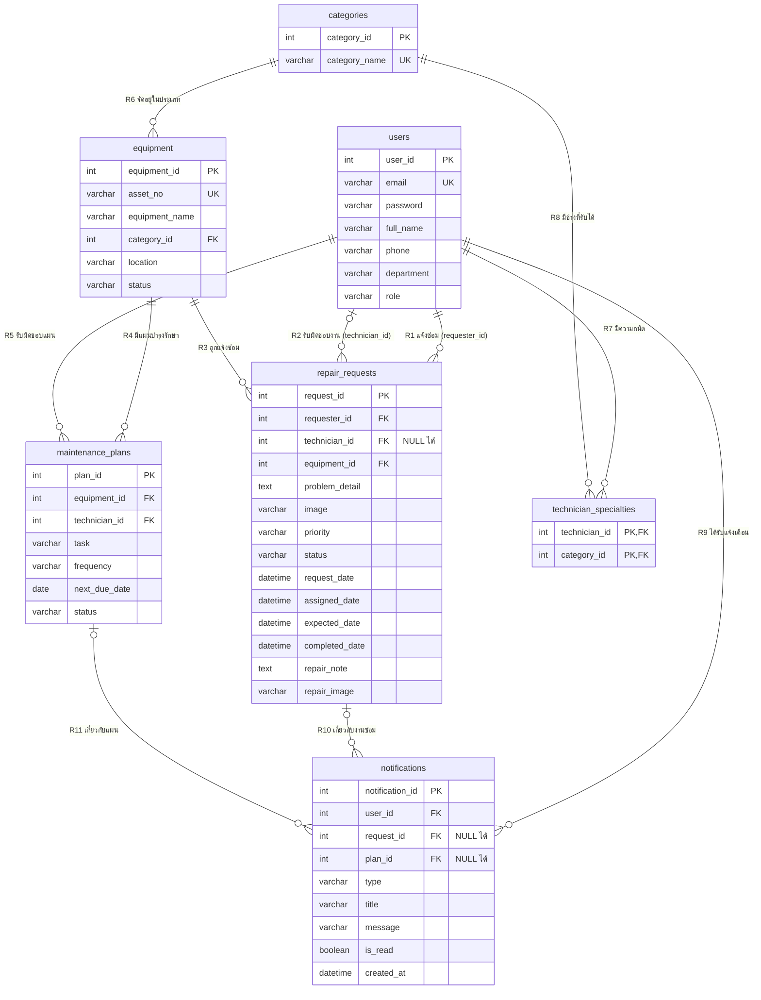
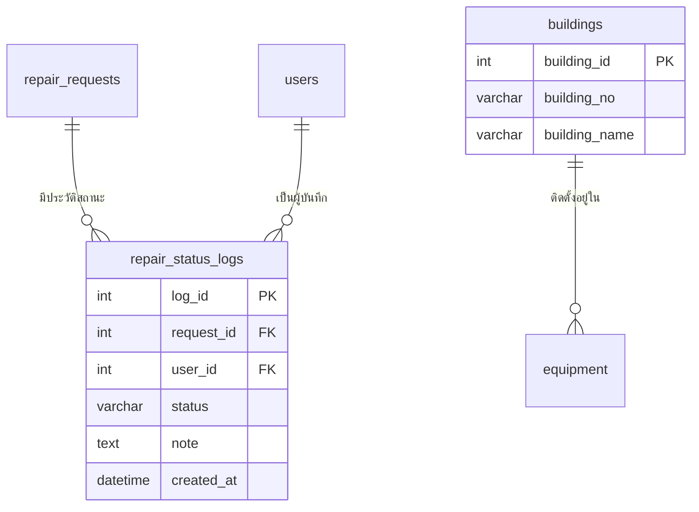

# เอกสารอธิบาย ERD — ระบบแจ้งซ่อมและบำรุงรักษา มหาวิทยาลัยรังสิต
### Entity Relationship Diagram & Data Dictionary

**วิชา CSC481** · ERD ฉบับปรับปรุง (7 ตาราง)

> ⚠️ **ภาพ [`erd fixed super final.png`](erd%20fixed%20super%20final.png) เป็น ERD ฉบับเก่า (4 ตาราง)** ฉบับปัจจุบันคือแผนภาพในหัวข้อ 1 ของเอกสารนี้ ถ้าจะวาดภาพใหม่ ใช้โค้ดใน [หัวข้อ 14](#14-โค้ดสำหรับวาด-erd-ใหม่-dbml) วางใน [dbdiagram.io](https://dbdiagram.io) ได้เลย

### สิ่งที่เปลี่ยนจาก ERD ฉบับเก่า

| เปลี่ยนอะไร | เหตุผล |
| :--- | :--- |
| เพิ่มตาราง **`categories`** (ประเภทงาน) และเปลี่ยน `equipment.category` (ข้อความ) เป็น **`equipment.category_id`** (FK) | ชื่อประเภทไม่ต้องพิมพ์ซ้ำทุกแถว และใช้เป็นตัวกลางจับคู่ "งานประเภทไหน" กับ "ช่างคนไหน" |
| เพิ่มตาราง **`technician_specialties`** (ช่าง ↔ ประเภทงานที่รับได้) | **แยกช่างตามความถนัด** ช่างแอร์รับงานประปาไม่ได้ ช่าง 1 คนรับได้หลายประเภท และประเภทหนึ่งมีช่างได้หลายคน (M : N) |
| เพิ่มตาราง **`notifications`** (การแจ้งเตือน) | **แจ้งเตือนช่าง** เมื่อได้รับมอบหมายงาน/แผน และเมื่องานหรือแผนเกินกำหนด (แจ้งแอดมินด้วยเมื่อเกินกำหนด) |

---

## 📌 สารบัญ

1. [ภาพรวมของ ERD](#1-ภาพรวมของ-erd)
2. [คีย์แต่ละตัวคืออะไร ใช้ทำอะไร (ฉบับอ่านง่าย)](#2-คีย์แต่ละตัวคืออะไร-ใช้ทำอะไร-ฉบับอ่านง่าย)
3. [Entity (ตาราง) ทั้งหมด](#3-entity-ตาราง-ทั้งหมด)
4. [Attribute ของแต่ละ Entity แบบละเอียด](#4-attribute-ของแต่ละ-entity-แบบละเอียด)
5. [Relationship (ความสัมพันธ์) ทั้งหมด](#5-relationship-ความสัมพันธ์-ทั้งหมด)
6. [การอ่านสัญลักษณ์ Crow's Foot](#6-การอ่านสัญลักษณ์-crows-foot)
7. [Data Dictionary — ค่าที่อนุญาตในแต่ละฟิลด์](#7-data-dictionary--ค่าที่อนุญาตในแต่ละฟิลด์)
8. [ข้อกำหนดความถูกต้องของข้อมูล (Integrity Constraints)](#8-ข้อกำหนดความถูกต้องของข้อมูล-integrity-constraints)
9. [ตัวอย่างข้อมูลในแต่ละตาราง](#9-ตัวอย่างข้อมูลในแต่ละตาราง)
10. [คำสั่ง SQL สร้างตาราง (DDL)](#10-คำสั่ง-sql-สร้างตาราง-ddl)
11. [ตัวอย่าง Query ที่ระบบใช้งานจริง](#11-ตัวอย่าง-query-ที่ระบบใช้งานจริง)
12. [การตรวจสอบ Normalization](#12-การตรวจสอบ-normalization)
13. [ERD เทียบกับการเก็บข้อมูลในระบบเดโม](#13-erd-เทียบกับการเก็บข้อมูลในระบบเดโม)
14. [โค้ดสำหรับวาด ERD ใหม่ (DBML)](#14-โค้ดสำหรับวาด-erd-ใหม่-dbml)

---

## 1. ภาพรวมของ ERD

| รายการ | จำนวน | รายละเอียด |
| :--- | :---: | :--- |
| Entity (ตาราง) | **7** | `users`, `categories`, `technician_specialties`, `equipment`, `repair_requests`, `maintenance_plans`, `notifications` |
| Attribute รวม | **47** | users 7 · categories 2 · technician_specialties 2 · equipment 6 · repair_requests 14 · maintenance_plans 7 · notifications 9 |
| Primary Key | **7** | 6 ตารางใช้ PK คอลัมน์เดียว · `technician_specialties` ใช้ **Composite PK** (2 คอลัมน์) |
| Foreign Key | **11** | technician_specialties 2 · equipment 1 · repair_requests 3 · maintenance_plans 2 · notifications 3 |
| Unique Key | **3** | `users.email`, `categories.category_name`, `equipment.asset_no` |
| Relationship | **11** | ทั้งหมดเป็น 1 : M · โดย R7 + R8 รวมกันแทนความสัมพันธ์ **M : N** ระหว่างช่างกับประเภทงาน |



**แนวคิดการออกแบบโดยสรุป**
- `users`, `categories`, `equipment` เป็น **ข้อมูลหลัก (Master Data)** ที่ตารางอื่นอ้างอิง
- `technician_specialties` เป็น **ตารางเชื่อม (Junction / Associative Entity)** แตกความสัมพันธ์ M : N ระหว่างช่างกับประเภทงาน
- `repair_requests` เป็น **ตารางธุรกรรม (Transaction)** เกิดขึ้นทุกครั้งที่มีการแจ้งซ่อม — ซ่อมเมื่อพัง (Corrective Maintenance)
- `maintenance_plans` เป็น **ตารางแผนงาน** สำหรับดูแลก่อนพัง (Preventive Maintenance)
- `notifications` เป็น **ตารางเหตุการณ์ (Event Log)** บันทึกว่าแจ้งอะไร ถึงใคร เมื่อไร อ่านแล้วหรือยัง
- ผู้แจ้ง ช่าง และแอดมิน อยู่ในตาราง `users` ตารางเดียว แยกด้วยฟิลด์ `role`

---

## 2. คีย์แต่ละตัวคืออะไร ใช้ทำอะไร (ฉบับอ่านง่าย)

### 🔑 คีย์คืออะไร?

**คีย์ (Key)** คือช่องข้อมูลที่ใช้ **ระบุตัวตน** หรือ **เชื่อมโยง** ข้อมูลระหว่างตาราง

นึกถึงชีวิตจริง:
- **เลขบัตรประชาชน** → ทุกคนมีเลขไม่ซ้ำกัน ใช้ระบุว่า "คนนี้คือใคร" = **Primary Key**
- **ช่อง "เลขบัตรประชาชนผู้ปกครอง" ในใบสมัครเรียน** → ไม่ได้เก็บชื่อ ที่อยู่ เบอร์ของผู้ปกครองซ้ำ แค่เก็บเลขไว้แล้วไปตามหาเอา = **Foreign Key**
- **อีเมล** → ไม่ใช่รหัสหลัก แต่ก็ห้ามใช้ซ้ำกับคนอื่น = **Unique Key**

### ระบบนี้มีคีย์ 3 แบบ

| คีย์ | ชื่อเต็ม | สรุปสั้น ๆ | กฎ | มีกี่ตัวในระบบนี้ |
| :---: | :--- | :--- | :--- | :---: |
| **PK** | Primary Key (คีย์หลัก) | "เลขประจำตัว" ของแต่ละแถว | ห้ามซ้ำ ห้ามว่าง แต่ละตารางมีได้ชุดเดียว | 7 |
| **FK** | Foreign Key (คีย์นอก / คีย์อ้างอิง) | "ลูกศรชี้" ไปหาแถวในตารางอื่น | ค่าต้องมีอยู่จริงในตารางที่ชี้ไป | 11 |
| **UK** | Unique Key (คีย์ห้ามซ้ำ) | ข้อมูลที่ห้ามซ้ำ แต่ไม่ใช่เลขประจำตัวหลัก | ห้ามซ้ำ | 3 |

---

### 🟡 Primary Key (PK) — เลขประจำตัวของแต่ละแถว

| PK | อยู่ในตาราง | ใช้ระบุอะไร | ตัวอย่าง | เอาไปใช้ทำอะไรในระบบ |
| :--- | :--- | :--- | :--- | :--- |
| `user_id` | `users` | ผู้ใช้ 1 คน | `2` = ธนากร ยั่งยืน | จำว่าใครล็อกอินอยู่, บอกว่าใครแจ้งซ่อม ใครเป็นช่าง ใครได้รับแจ้งเตือน |
| `category_id` | `categories` | ประเภทงาน 1 ประเภท | `1` = ระบบปรับอากาศ | ใช้จับคู่ครุภัณฑ์กับช่างที่รับงานประเภทนั้นได้ |
| `technician_id` + `category_id` | `technician_specialties` | "ช่างคนนี้รับงานประเภทนี้ได้" 1 คู่ | `(4, 4)` = ณภัทร รับงานประปา | หน้ามอบหมายงานแสดงเฉพาะช่างที่มีคู่นี้อยู่ |
| `equipment_id` | `equipment` | ครุภัณฑ์ 1 ชิ้น | `1` = แอร์ AC-003 | บอกว่าใบแจ้งซ่อม/แผนบำรุงรักษาเป็นของเครื่องไหน |
| `request_id` | `repair_requests` | ใบแจ้งซ่อม 1 ใบ | `1` = แอร์ห้อง 302 ไม่เย็น | เปิดดูใบงาน, อัปเดตสถานะ, มอบหมายช่าง |
| `plan_id` | `maintenance_plans` | แผนบำรุงรักษา 1 แผน | `1` = ล้างแอร์ AC-001 ทุก 3 เดือน | กด "บันทึกการทำบำรุง" หรือ "เลื่อนกำหนด" |
| `notification_id` | `notifications` | การแจ้งเตือน 1 รายการ | `12` = "ได้รับมอบหมายงานซ่อม RQ-…" | กดแล้วระบบบันทึกว่าอ่านแล้ว |

> 💬 **Composite Primary Key คืออะไร?** — PK ที่ใช้ **2 คอลัมน์รวมกัน** ในตาราง `technician_specialties` คู่ `(technician_id, category_id)` ห้ามซ้ำ แปลว่าช่างคนหนึ่งจะถูกบันทึกว่ารับงานประเภทเดียวกันซ้ำ 2 ครั้งไม่ได้ แต่ช่างคนเดียวกันรับหลายประเภทได้ (ณภัทร = `(4, 3)` ไฟฟ้า และ `(4, 4)` ประปา)

> 💬 **ทำไมไม่ใช้ชื่อเป็น PK?** — ชื่อซ้ำกันได้และเปลี่ยนได้ ถ้าใช้ชื่อเป็น PK ระบบจะสับสนว่าหมายถึงแถวไหน ตัวเลขที่ระบบรันให้จึงปลอดภัยที่สุด

---

### 🔵 Foreign Key (FK) — ลูกศรชี้ไปหาตารางอื่น

FK คือช่องที่ **เก็บค่า PK ของอีกตาราง** เพื่อบอกว่า "แถวนี้เกี่ยวข้องกับแถวนั้น" แทนที่จะคัดลอกข้อมูลทั้งก้อนมาเก็บซ้ำ

| FK | อยู่ในตาราง | ชี้ไปที่ | แปลว่า | ว่างได้ไหม | เอาไปใช้ทำอะไรในระบบ |
| :--- | :--- | :--- | :--- | :---: | :--- |
| `technician_id` | `technician_specialties` | `users.user_id` | **ช่างคนไหน** | ❌ | — |
| `category_id` | `technician_specialties` | `categories.category_id` | **รับงานประเภทไหนได้** | ❌ | กรองรายชื่อช่างในหน้ามอบหมายงานและหน้าเพิ่มแผน |
| `category_id` | `equipment` | `categories.category_id` | **ครุภัณฑ์นี้เป็นงานประเภทไหน** | ❌ | กรองทะเบียนครุภัณฑ์ · บอกว่าต้องใช้ช่างสายไหน |
| `requester_id` | `repair_requests` | `users.user_id` | **ใครเป็นคนแจ้งซ่อม** | ❌ | แสดงชื่อ หน่วยงาน เบอร์ผู้แจ้งในหน้าติดตามงาน |
| `technician_id` | `repair_requests` | `users.user_id` | **ช่างคนไหนรับงานนี้** | ✅ | ว่าง = "รอมอบหมาย" · หน้างานของช่างดึงงานที่ช่องนี้ตรงกับคนที่ล็อกอิน |
| `equipment_id` | `repair_requests` | `equipment.equipment_id` | **เครื่องไหนเสีย** | ❌ | แสดงครุภัณฑ์ในใบงาน · ประวัติการซ่อม · เปลี่ยนสถานะครุภัณฑ์อัตโนมัติ |
| `equipment_id` | `maintenance_plans` | `equipment.equipment_id` | **แผนนี้ดูแลเครื่องไหน** | ❌ | คอลัมน์ "บำรุงรักษาครั้งถัดไป" ในทะเบียนครุภัณฑ์ |
| `technician_id` | `maintenance_plans` | `users.user_id` | **ใครรับผิดชอบแผนนี้** | ❌ | แสดงผู้รับผิดชอบ · ช่างกดบันทึก/เลื่อนกำหนดได้เฉพาะแผนของตัวเอง |
| `user_id` | `notifications` | `users.user_id` | **แจ้งเตือนถึงใคร** | ❌ | กระดิ่งมุมขวาบนแสดงเฉพาะของคนที่ล็อกอิน |
| `request_id` | `notifications` | `repair_requests.request_id` | **เกี่ยวกับงานซ่อมใบไหน** | ✅ | กดแจ้งเตือนแล้วเปิดใบงานนั้น |
| `plan_id` | `notifications` | `maintenance_plans.plan_id` | **เกี่ยวกับแผนไหน** | ✅ | กดแจ้งเตือนแล้วเปิดหน้าแผนบำรุงรักษา |

> 💬 **ทำไม `technician_id` ในใบแจ้งซ่อมว่างได้ แต่ในแผนบำรุงรักษาว่างไม่ได้?** — ตอนแจ้งซ่อมยังไม่รู้ว่าช่างคนไหนจะรับ ต้องรอแอดมินมอบหมายก่อน ส่วนแผนบำรุงรักษาถูกสร้างโดยแอดมินที่กำหนดผู้รับผิดชอบไว้ตั้งแต่แรก

> 💬 **ทำไม `notifications` มีทั้ง `request_id` และ `plan_id` ที่ว่างได้?** — การแจ้งเตือน 1 รายการเกี่ยวกับ **งานซ่อม หรือ แผน อย่างใดอย่างหนึ่ง** จึงมีค่าในช่องเดียว อีกช่องเป็น NULL (มี CHECK บังคับว่าห้ามมีค่าทั้งสองช่องพร้อมกัน)

---

### 🟢 Unique Key (UK) — ห้ามซ้ำ แต่ไม่ใช่รหัสหลัก

| UK | อยู่ในตาราง | ทำไมต้องห้ามซ้ำ | เอาไปใช้ทำอะไรในระบบ |
| :--- | :--- | :--- | :--- |
| `email` | `users` | ใช้เป็นชื่อเข้าสู่ระบบ ถ้าซ้ำระบบจะไม่รู้ว่าล็อกอินเป็นใคร | ล็อกอิน · รีเซ็ตรหัสผ่าน · สมัครด้วยอีเมลที่มีอยู่แล้วระบบจะไม่ยอม |
| `category_name` | `categories` | ประเภทงานชื่อเดียวกันต้องมีแค่แถวเดียว | รายการประเภทในตัวกรองและฟอร์มต่าง ๆ |
| `asset_no` | `equipment` | เลขครุภัณฑ์ที่ติดอยู่บนตัวเครื่องจริง เครื่องละ 1 เลข | ค้นหาครุภัณฑ์ · เพิ่มครุภัณฑ์ด้วยเลขที่มีอยู่แล้วระบบจะไม่ยอม |

---

### 🔍 ลองตามคีย์ดูจริง: ทำไมงานแอร์มอบหมายให้ช่างประปาไม่ได้

```text
repair_requests (request_id = 1) "เครื่องปรับอากาศไม่เย็น"
 └── equipment_id = 1 ──► equipment (AC-003)
                            └── category_id = 1 ──► categories → "ระบบปรับอากาศ"

ช่างที่มีแถว category_id = 1 ใน technician_specialties:
   (2, 1)  ──► users user_id = 2 → ธนากร ยั่งยืน    ✅ มอบหมายได้
ช่างที่ไม่มีแถวนี้:
   (4, 3), (4, 4) ──► users user_id = 4 → ณภัทร สาระคำ (ไฟฟ้า, ประปา)   ❌ ไม่แสดงในรายชื่อ
```

นี่คือสิ่งที่หน้าต่าง **มอบหมายช่าง** ทำ: ตามคีย์จากใบงาน → ครุภัณฑ์ → ประเภทงาน แล้วแสดงเฉพาะช่างที่มีคู่ `(ช่าง, ประเภท)` นั้นใน `technician_specialties` (SQL ดู [Q3 ในหัวข้อ 11](#11-ตัวอย่าง-query-ที่ระบบใช้งานจริง))

---

### 📋 สรุปคีย์ทั้งหมดในหน้าเดียว

| ตาราง | PK | FK | UK |
| :--- | :--- | :--- | :--- |
| `users` | `user_id` | – | `email` |
| `categories` | `category_id` | – | `category_name` |
| `technician_specialties` | `technician_id` + `category_id` | `technician_id` → users · `category_id` → categories | – |
| `equipment` | `equipment_id` | `category_id` → categories | `asset_no` |
| `repair_requests` | `request_id` | `requester_id` → users · `technician_id` → users · `equipment_id` → equipment | – |
| `maintenance_plans` | `plan_id` | `equipment_id` → equipment · `technician_id` → users | – |
| `notifications` | `notification_id` | `user_id` → users · `request_id` → repair_requests · `plan_id` → maintenance_plans | – |

---

## 3. Entity (ตาราง) ทั้งหมด

| # | Entity | ประเภท | เก็บข้อมูลอะไร | Primary Key | ตัวอย่าง 1 แถว |
| :---: | :--- | :--- | :--- | :--- | :--- |
| 1 | `users` | Master | บุคลากรทุกคนที่ใช้ระบบ: เจ้าหน้าที่ (ผู้แจ้ง), ช่างเทคนิค, ผู้ดูแลระบบ | `user_id` | ธนากร ยั่งยืน — ช่างเทคนิค |
| 2 | `categories` | Master / Lookup | ประเภทงาน 6 ประเภท | `category_id` | ระบบปรับอากาศ |
| 3 | `technician_specialties` | Junction (M : N) | ช่างแต่ละคนรับงานประเภทไหนได้ | `technician_id` + `category_id` | (ณภัทร, ระบบประปา) |
| 4 | `equipment` | Master | ครุภัณฑ์ทุกชิ้นที่ติดตั้งในอาคารต่าง ๆ | `equipment_id` | AC-003 เครื่องปรับอากาศ 24,000 บีทียู |
| 5 | `repair_requests` | Transaction | ใบแจ้งซ่อม 1 ใบต่อปัญหา 1 ครั้ง ตั้งแต่แจ้งจนปิดงาน | `request_id` | แอร์ห้องประชุม 302 ไม่เย็น |
| 6 | `maintenance_plans` | Plan / Schedule | แผนบำรุงรักษาตามรอบของครุภัณฑ์แต่ละชิ้น | `plan_id` | ล้างแผงกรองแอร์ AC-001 ทุก 3 เดือน |
| 7 | `notifications` | Event Log | การแจ้งเตือนถึงผู้ใช้แต่ละคน | `notification_id` | ธนากร: "ได้รับมอบหมายงานซ่อม RQ-691028-014" |

---

## 4. Attribute ของแต่ละ Entity แบบละเอียด

> **สัญลักษณ์:** **PK** = Primary Key · **FK** = Foreign Key · **UK** = Unique Key · **NN** = Not Null (ห้ามว่าง) · **N** = Nullable (ว่างได้)

### 4.1 `users` — ผู้ใช้งานและบุคลากร (7 attributes)

| # | Attribute | ชนิดข้อมูล | คีย์ | Null | ค่าที่อนุญาต / เงื่อนไข | ตัวอย่าง | คำอธิบาย |
| :---: | :--- | :--- | :---: | :---: | :--- | :--- | :--- |
| 1 | `user_id` | `int` | **PK** | NN | Auto Increment | `2` | รหัสผู้ใช้ |
| 2 | `email` | `varchar(150)` | **UK** | NN | รูปแบบอีเมล, ห้ามซ้ำ | `thanakorn.y68@rsu.ac.th` | ชื่อเข้าสู่ระบบ |
| 3 | `password` | `varchar(255)` | | NN | อย่างน้อย 6 ตัวอักษร | `password123` | รหัสผ่าน (ระบบจริงเก็บเป็น Hash จึงเผื่อไว้ 255) |
| 4 | `full_name` | `varchar(100)` | | NN | | `ธนากร ยั่งยืน` | ชื่อ - นามสกุล |
| 5 | `phone` | `varchar(30)` | | N | | `ต่อ 1206` | เบอร์ติดต่อ ใช้ยืนยันตัวตนตอนรีเซ็ตรหัสผ่าน |
| 6 | `department` | `varchar(100)` | | NN | | `สำนักงานอาคารและสิ่งแวดล้อม (ตึก 13)` | หน่วยงานต้นสังกัด |
| 7 | `role` | `varchar(30)` | | NN | `ผู้ดูแลระบบ`, `ช่างเทคนิค`, `เจ้าหน้าที่` | `ช่างเทคนิค` | บทบาท กำหนดสิทธิ์การเข้าถึงหน้าจอ |

### 4.2 `categories` — ประเภทงาน (2 attributes)

| # | Attribute | ชนิดข้อมูล | คีย์ | Null | ค่าที่อนุญาต / เงื่อนไข | ตัวอย่าง | คำอธิบาย |
| :---: | :--- | :--- | :---: | :---: | :--- | :--- | :--- |
| 1 | `category_id` | `int` | **PK** | NN | Auto Increment | `1` | รหัสประเภทงาน |
| 2 | `category_name` | `varchar(50)` | **UK** | NN | ห้ามซ้ำ | `ระบบปรับอากาศ` | ชื่อประเภทงาน |

### 4.3 `technician_specialties` — ความถนัดของช่าง (2 attributes)

| # | Attribute | ชนิดข้อมูล | คีย์ | Null | ค่าที่อนุญาต / เงื่อนไข | ตัวอย่าง | คำอธิบาย |
| :---: | :--- | :--- | :---: | :---: | :--- | :--- | :--- |
| 1 | `technician_id` | `int` | **PK**, **FK** → `users.user_id` | NN | ผู้ใช้ที่ `role = ช่างเทคนิค` | `4` | ช่าง |
| 2 | `category_id` | `int` | **PK**, **FK** → `categories.category_id` | NN | | `4` | ประเภทงานที่ช่างคนนี้รับได้ |

> 1 แถว = "ช่างคนนี้รับงานประเภทนี้ได้" · ช่างที่รับ 2 ประเภทจะมี 2 แถว

### 4.4 `equipment` — ทะเบียนครุภัณฑ์ (6 attributes)

| # | Attribute | ชนิดข้อมูล | คีย์ | Null | ค่าที่อนุญาต / เงื่อนไข | ตัวอย่าง | คำอธิบาย |
| :---: | :--- | :--- | :---: | :---: | :--- | :--- | :--- |
| 1 | `equipment_id` | `int` | **PK** | NN | Auto Increment | `1` | รหัสภายในระบบ (Surrogate Key) |
| 2 | `asset_no` | `varchar(50)` | **UK** | NN | ห้ามซ้ำ | `AC-003` | เลขครุภัณฑ์ของมหาวิทยาลัย |
| 3 | `equipment_name` | `varchar(150)` | | NN | | `เครื่องปรับอากาศ 24,000 บีทียู` | ชื่อและคุณลักษณะ |
| 4 | `category_id` | `int` | **FK** → `categories.category_id` | NN | | `1` | ประเภทงาน — ใช้เลือกช่างที่รับงานได้ |
| 5 | `location` | `varchar(150)` | | NN | | `ห้องประชุม 302 · ชั้น 3` | สถานที่ติดตั้ง |
| 6 | `status` | `varchar(30)` | | NN | `ใช้งานปกติ`, `รอตรวจสอบ`, `อยู่ระหว่างซ่อม` | `อยู่ระหว่างซ่อม` | สถานะความพร้อมใช้งาน (อัปเดตตามใบแจ้งซ่อมอัตโนมัติ) |

> ❓ **ทำไมมีทั้ง `equipment_id` และ `asset_no`?** — `asset_no` คือเลขที่คนตั้งและอาจเปลี่ยนได้ ถ้าใช้เป็น FK ต้องตามแก้ทุกตาราง จึงใช้ `equipment_id` ที่ไม่มีวันเปลี่ยนเป็น PK และบังคับให้ `asset_no` ไม่ซ้ำด้วย Unique Key

### 4.5 `repair_requests` — ใบแจ้งซ่อม (14 attributes)

| # | Attribute | ชนิดข้อมูล | คีย์ | Null | ค่าที่อนุญาต / เงื่อนไข | ตัวอย่าง | คำอธิบาย |
| :---: | :--- | :--- | :---: | :---: | :--- | :--- | :--- |
| 1 | `request_id` | `int` | **PK** | NN | Auto Increment | `1` | รหัสใบแจ้งซ่อม |
| 2 | `requester_id` | `int` | **FK** → `users.user_id` | NN | | `3` | ผู้แจ้งซ่อม |
| 3 | `technician_id` | `int` | **FK** → `users.user_id` | **N** | ต้องเป็นช่างที่รับงานประเภทของครุภัณฑ์ได้ | `2` | ช่างผู้รับผิดชอบ — **NULL = ยังไม่ได้มอบหมาย** |
| 4 | `equipment_id` | `int` | **FK** → `equipment.equipment_id` | NN | | `1` | ครุภัณฑ์ที่ชำรุด |
| 5 | `problem_detail` | `text` | | NN | | `เครื่องปรับอากาศไม่เย็น มีแต่ลมออก…` | รายละเอียดอาการ |
| 6 | `image` | `varchar(255)` | | N | | `แอร์ห้องประชุม302.jpg` | ไฟล์รูปหน้างานก่อนซ่อม |
| 7 | `priority` | `varchar(20)` | | NN | `ต่ำ`, `ปกติ`, `เร่งด่วน` | `เร่งด่วน` | ระดับความสำคัญ (ใช้กำหนดเส้นตายถ้ายังไม่มี ETA) |
| 8 | `status` | `varchar(30)` | | NN | `รอดำเนินการ`, `กำลังดำเนินการ`, `เสร็จสิ้น` | `กำลังดำเนินการ` | สถานะงาน |
| 9 | `request_date` | `datetime` | | NN | ค่าเริ่มต้น = เวลาปัจจุบัน | `2026-10-28 08:45` | เวลาที่แจ้ง |
| 10 | `assigned_date` | `datetime` | | N | ≥ `request_date` | `2026-10-28 09:00` | เวลาที่มอบหมายช่าง |
| 11 | `expected_date` | `datetime` | | N | | `2026-10-28 12:00` | เวลาที่ช่างคาดว่าจะเสร็จ (ETA) — เลยแล้วยังไม่เสร็จ = เกินกำหนด |
| 12 | `completed_date` | `datetime` | | N | ต้องมีค่าเมื่อ `status = เสร็จสิ้น` | `NULL` | เวลาที่ปิดงาน |
| 13 | `repair_note` | `text` | | N | | `ตรวจพบสารทำความเย็นรั่ว…` | บันทึกของช่าง |
| 14 | `repair_image` | `varchar(255)` | | N | | `NULL` | ไฟล์หลักฐานหลังซ่อม |

### 4.6 `maintenance_plans` — แผนบำรุงรักษาเชิงป้องกัน (7 attributes)

| # | Attribute | ชนิดข้อมูล | คีย์ | Null | ค่าที่อนุญาต / เงื่อนไข | ตัวอย่าง | คำอธิบาย |
| :---: | :--- | :--- | :---: | :---: | :--- | :--- | :--- |
| 1 | `plan_id` | `int` | **PK** | NN | Auto Increment | `1` | รหัสแผน |
| 2 | `equipment_id` | `int` | **FK** → `equipment.equipment_id` | NN | | `8` | ครุภัณฑ์ที่ต้องบำรุงรักษา |
| 3 | `technician_id` | `int` | **FK** → `users.user_id` | NN | ต้องเป็นช่างที่รับงานประเภทของครุภัณฑ์ได้ | `2` | ผู้รับผิดชอบแผน |
| 4 | `task` | `varchar(150)` | | NN | | `ล้างแผงกรอง / ตรวจน้ำยา` | รายการงาน |
| 5 | `frequency` | `varchar(50)` | | NN | `ทุก 1 เดือน`, `ทุก 3 เดือน`, `ทุก 6 เดือน`, `ทุก 1 ปี` | `ทุก 3 เดือน` | รอบการดูแล |
| 6 | `next_due_date` | `date` | | NN | | `2026-10-27` | กำหนดครั้งถัดไป |
| 7 | `status` | `varchar(30)` | | NN | `รอดำเนินการ`, `ใกล้ครบกำหนด`, `เกินกำหนด` | `เกินกำหนด` | สถานะแผน (ในระบบคำนวณจาก `next_due_date`) |

### 4.7 `notifications` — การแจ้งเตือน (9 attributes)

| # | Attribute | ชนิดข้อมูล | คีย์ | Null | ค่าที่อนุญาต / เงื่อนไข | ตัวอย่าง | คำอธิบาย |
| :---: | :--- | :--- | :---: | :---: | :--- | :--- | :--- |
| 1 | `notification_id` | `int` | **PK** | NN | Auto Increment | `12` | รหัสการแจ้งเตือน |
| 2 | `user_id` | `int` | **FK** → `users.user_id` | NN | | `2` | ผู้รับแจ้งเตือน |
| 3 | `request_id` | `int` | **FK** → `repair_requests.request_id` | **N** | มีค่าเมื่อเป็นเรื่องงานซ่อม | `1` | ใบงานที่เกี่ยวข้อง |
| 4 | `plan_id` | `int` | **FK** → `maintenance_plans.plan_id` | **N** | มีค่าเมื่อเป็นเรื่องแผน | `NULL` | แผนที่เกี่ยวข้อง |
| 5 | `type` | `varchar(30)` | | NN | `assigned_repair`, `assigned_plan`, `overdue_repair`, `overdue_plan` | `assigned_repair` | ชนิดการแจ้งเตือน |
| 6 | `title` | `varchar(100)` | | NN | | `ได้รับมอบหมายงานซ่อม` | หัวข้อ |
| 7 | `message` | `varchar(255)` | | NN | | `RQ-691028-014 · เครื่องปรับอากาศไม่เย็น · ตึก 1 ห้องประชุม 302` | ข้อความ |
| 8 | `is_read` | `boolean` | | NN | ค่าเริ่มต้น `false` | `false` | อ่านแล้วหรือยัง (นับเป็นตัวเลขบนกระดิ่ง) |
| 9 | `created_at` | `datetime` | | NN | ค่าเริ่มต้น = เวลาปัจจุบัน | `2026-11-05 09:12` | เวลาที่แจ้ง |

---

## 5. Relationship (ความสัมพันธ์) ทั้งหมด

| # | ชื่อความสัมพันธ์ | ตารางแม่ (1) | ตารางลูก (M) | FK ที่เชื่อม | Cardinality | Participation (ฝั่งลูก) | อธิบาย |
| :---: | :--- | :--- | :--- | :--- | :---: | :--- | :--- |
| R1 | **แจ้งซ่อม** | `users` | `repair_requests` | `requester_id` | 1 : M | **บังคับ** | ผู้ใช้ 1 คนแจ้งได้ 0..N ใบ · ใบแจ้ง 1 ใบมีผู้แจ้ง 1 คน |
| R2 | **รับผิดชอบงานซ่อม** | `users` | `repair_requests` | `technician_id` | 1 : M | **ไม่บังคับ** (ว่างระหว่างรอมอบหมาย) | ช่าง 1 คนรับได้ 0..N ใบ · ใบแจ้ง 1 ใบมีช่าง 0..1 คน |
| R3 | **ถูกแจ้งซ่อม** | `equipment` | `repair_requests` | `equipment_id` | 1 : M | **บังคับ** | ครุภัณฑ์ 1 ชิ้นถูกแจ้งได้ 0..N ครั้ง |
| R4 | **มีแผนบำรุงรักษา** | `equipment` | `maintenance_plans` | `equipment_id` | 1 : M | **บังคับ** | ครุภัณฑ์ 1 ชิ้นมีได้ 0..N แผน |
| R5 | **รับผิดชอบแผน** | `users` | `maintenance_plans` | `technician_id` | 1 : M | **บังคับ** | ช่าง 1 คนดูแลได้ 0..N แผน |
| R6 | **จัดอยู่ในประเภท** | `categories` | `equipment` | `category_id` | 1 : M | **บังคับ** | ประเภท 1 ประเภทมีครุภัณฑ์ 0..N ชิ้น · ครุภัณฑ์ 1 ชิ้นอยู่ 1 ประเภท |
| R7 | **มีความถนัด** | `users` | `technician_specialties` | `technician_id` | 1 : M | **บังคับ** | ช่าง 1 คนมีความถนัด 0..N ประเภท |
| R8 | **มีช่างที่รับได้** | `categories` | `technician_specialties` | `category_id` | 1 : M | **บังคับ** | ประเภท 1 ประเภทมีช่างที่รับได้ 0..N คน |
| R9 | **ได้รับแจ้งเตือน** | `users` | `notifications` | `user_id` | 1 : M | **บังคับ** | ผู้ใช้ 1 คนได้รับแจ้งเตือน 0..N รายการ |
| R10 | **แจ้งเตือนเรื่องงานซ่อม** | `repair_requests` | `notifications` | `request_id` | 1 : M | **ไม่บังคับ** | ใบงาน 1 ใบมีแจ้งเตือน 0..N รายการ |
| R11 | **แจ้งเตือนเรื่องแผน** | `maintenance_plans` | `notifications` | `plan_id` | 1 : M | **ไม่บังคับ** | แผน 1 แผนมีแจ้งเตือน 0..N รายการ |

### เขียนแบบ (min, max)

| ความสัมพันธ์ | ฝั่งตารางแม่ | ฝั่งตารางลูก | อ่านว่า |
| :--- | :---: | :---: | :--- |
| R1 users — repair_requests (ผู้แจ้ง) | (1, 1) | (0, N) | ใบแจ้งซ่อมต้องมีผู้แจ้ง **1 คนพอดี** |
| R2 users — repair_requests (ช่าง) | (0, 1) | (0, N) | ใบแจ้งซ่อมมีช่าง **ไม่มี หรือ 1 คน** |
| R3 equipment — repair_requests | (1, 1) | (0, N) | ใบแจ้งซ่อมต้องระบุครุภัณฑ์ **1 ชิ้นพอดี** |
| R4 equipment — maintenance_plans | (1, 1) | (0, N) | แผนต้องเป็นของครุภัณฑ์ **1 ชิ้นพอดี** |
| R5 users — maintenance_plans | (1, 1) | (0, N) | แผนต้องมีผู้รับผิดชอบ **1 คนพอดี** |
| R6 categories — equipment | (1, 1) | (0, N) | ครุภัณฑ์ต้องอยู่ใน **1 ประเภทพอดี** |
| R7 users — technician_specialties | (1, 1) | (0, N) | แต่ละแถวความถนัดเป็นของ **ช่าง 1 คน** |
| R8 categories — technician_specialties | (1, 1) | (0, N) | แต่ละแถวความถนัดระบุ **ประเภท 1 ประเภท** |
| R9 users — notifications | (1, 1) | (0, N) | แจ้งเตือนแต่ละรายการถึง **ผู้ใช้ 1 คน** |
| R10 repair_requests — notifications | (0, 1) | (0, N) | แจ้งเตือนเกี่ยวกับงานซ่อม **ไม่มี หรือ 1 ใบ** |
| R11 maintenance_plans — notifications | (0, 1) | (0, N) | แจ้งเตือนเกี่ยวกับแผน **ไม่มี หรือ 1 แผน** |

### ความสัมพันธ์ M : N ระหว่างช่างกับประเภทงาน

ในความจริง **ช่าง 1 คนรับได้หลายประเภท** (ณภัทร: ไฟฟ้า + ประปา) และ **ประเภทหนึ่งมีช่างได้หลายคน** (ประปา: ณภัทร + ช่างที่สมัครเพิ่ม) จึงเป็น M : N

ฐานข้อมูลเชิงสัมพันธ์เก็บ M : N ตรง ๆ ไม่ได้ (ถ้าใส่ช่องประเภทใน `users` จะต้องเก็บหลายค่าในช่องเดียว ผิด 1NF) จึงสร้างตารางเชื่อม `technician_specialties` แล้วแตกเป็น 1 : M สองเส้น (R7 และ R8)

```text
users (M) ──────────────── (N) categories
        ⇩ แตกด้วยตารางเชื่อม
users (1) ──< technician_specialties >── (1) categories
```

---

## 6. การอ่านสัญลักษณ์ Crow's Foot

| สัญลักษณ์ | ชื่อ | ความหมาย | ใช้ที่ไหนใน ERD นี้ |
| :---: | :--- | :--- | :--- |
| `\|\|` | One and only one | 1 พอดี (บังคับ) | ฝั่งตารางแม่ของ R1, R3–R9 |
| `o\|` | Zero or one | 0 หรือ 1 (ไม่บังคับ) | ฝั่งตารางแม่ของ R2 (ช่างของใบแจ้งซ่อม), R10, R11 |
| `o{` | Zero or many | 0 ถึงหลาย | ฝั่งตารางลูกทุกเส้น |
| `\|{` | One or many | 1 ถึงหลาย (บังคับ) | ไม่ได้ใช้ — ผู้ใช้หรือครุภัณฑ์ใหม่ยังไม่มีข้อมูลลูกได้ |

---

## 7. Data Dictionary — ค่าที่อนุญาตในแต่ละฟิลด์

| ฟิลด์ | ค่าที่อนุญาต | ความหมาย |
| :--- | :--- | :--- |
| `users.role` | `เจ้าหน้าที่` | อาจารย์/บุคลากร แจ้งซ่อมและติดตามงาน |
| | `ช่างเทคนิค` | รับงานซ่อมและแผนบำรุงรักษาเฉพาะประเภทที่ตนถนัด |
| | `ผู้ดูแลระบบ` | มอบหมายช่าง จัดการครุภัณฑ์และแผนบำรุงรักษา |
| `categories.category_name` | `ระบบปรับอากาศ` · `อุปกรณ์สำนักงาน` · `ระบบไฟฟ้า` · `ระบบประปา` · `คอมพิวเตอร์` · `อาคารและสถานที่` | ประเภทงาน 6 ประเภท |
| `equipment.status` | `ใช้งานปกติ` | ไม่มีใบแจ้งซ่อมค้าง |
| | `รอตรวจสอบ` | มีใบแจ้งซ่อมที่ยังไม่เริ่มซ่อม |
| | `อยู่ระหว่างซ่อม` | มีใบแจ้งซ่อมที่กำลังดำเนินการ |
| `repair_requests.priority` | `ต่ำ` · `ปกติ` · `เร่งด่วน` | ถ้ายังไม่มี ETA เส้นตาย = วันที่แจ้ง + 7 / 3 / 1 วัน ตามลำดับ |
| `repair_requests.status` | `รอดำเนินการ` | แจ้งแล้ว รอมอบหมาย หรือมอบหมายแล้วแต่ช่างยังไม่เริ่ม |
| | `กำลังดำเนินการ` | ช่างกำลังซ่อม |
| | `เสร็จสิ้น` | ปิดงานแล้ว |
| `maintenance_plans.frequency` | `ทุก 1 เดือน` · `ทุก 3 เดือน` · `ทุก 6 เดือน` · `ทุก 1 ปี` | รอบการดูแล |
| `maintenance_plans.status` | `รอดำเนินการ` / `ใกล้ครบกำหนด` / `เกินกำหนด` | เหลือ > 7 วัน / ≤ 7 วัน / เลยกำหนดแล้ว |
| `notifications.type` | `assigned_repair` | ช่างได้รับมอบหมายงานซ่อม (แจ้งช่าง) |
| | `assigned_plan` | ช่างได้รับมอบหมายแผนบำรุงรักษา (แจ้งช่าง) |
| | `overdue_repair` | งานซ่อมเกินกำหนด (แจ้งช่างที่รับงาน + แอดมินทุกคน) |
| | `overdue_plan` | แผนบำรุงรักษาเกินกำหนด (แจ้งช่างผู้รับผิดชอบ + แอดมินทุกคน) |

---

## 8. ข้อกำหนดความถูกต้องของข้อมูล (Integrity Constraints)

| ประเภท | กฎ | บังคับด้วย |
| :--- | :--- | :--- |
| **Entity Integrity** | PK ทุกตารางห้ามว่างและห้ามซ้ำ | `PRIMARY KEY` |
| **Referential Integrity** | FK ต้องชี้ไปยังแถวที่มีอยู่จริง | `FOREIGN KEY … REFERENCES` |
| **Unique** | อีเมลผู้ใช้ · ชื่อประเภทงาน · เลขครุภัณฑ์ ห้ามซ้ำ | `UNIQUE` |
| **Domain** | ฟิลด์สถานะ/บทบาท/ความสำคัญ/รอบดูแล/ชนิดแจ้งเตือน ใช้ได้เฉพาะค่าในหัวข้อ 7 | `CHECK (… IN (…))` |
| **Business Rule** | งานที่ `เสร็จสิ้น` ต้องมี `completed_date` | `CHECK` |
| **Business Rule** | งานที่ `กำลังดำเนินการ` หรือ `เสร็จสิ้น` ต้องมีช่าง | `CHECK` |
| **Business Rule** | วันที่มอบหมาย/ปิดงาน ต้องไม่ก่อนวันที่แจ้ง | `CHECK` |
| **Business Rule** | แจ้งเตือน 1 รายการเกี่ยวกับงานซ่อม **หรือ** แผน ไม่ใช่ทั้งสองอย่าง | `CHECK` |
| **Business Rule (ข้ามตาราง)** | ช่างที่มอบหมายในใบแจ้งซ่อมและแผน ต้องมีแถวใน `technician_specialties` ตรงกับ `category_id` ของครุภัณฑ์ | ตรวจในโปรแกรมก่อนบันทึก ([Q3](#11-ตัวอย่าง-query-ที่ระบบใช้งานจริง)) หรือใช้ Trigger · CHECK อ้างอิงข้ามตารางไม่ได้ |

### เมื่อลบข้อมูลในตารางแม่ (ON DELETE)

| FK | นโยบาย | เหตุผล |
| :--- | :--- | :--- |
| `technician_specialties.technician_id` | `CASCADE` | ลบช่าง ความถนัดของช่างคนนั้นก็หมดความหมาย |
| `technician_specialties.category_id` | `RESTRICT` | ต้องจัดการช่างในประเภทนั้นก่อนลบประเภท |
| `equipment.category_id` | `RESTRICT` | ห้ามลบประเภทที่ยังมีครุภัณฑ์อยู่ |
| `repair_requests.requester_id` | `RESTRICT` | ห้ามลบผู้ใช้ที่เคยแจ้งซ่อม เพื่อเก็บประวัติ |
| `repair_requests.technician_id` | `SET NULL` | ช่างลาออก ใบงานที่ยังไม่เริ่มกลับเป็น "รอมอบหมาย" · ถ้ามีงาน "กำลังดำเนินการ" ค้าง `chk_started_has_tech` จะไม่ยอมให้ลบ ต้องโอนงานก่อน |
| `repair_requests.equipment_id` | `RESTRICT` | ห้ามลบครุภัณฑ์ที่มีประวัติซ่อม |
| `maintenance_plans.equipment_id` | `CASCADE` | ครุภัณฑ์ถูกตัดออกจากทะเบียน แผนของมันก็ไม่มีความหมาย |
| `maintenance_plans.technician_id` | `RESTRICT` | ต้องโอนแผนให้ช่างคนอื่นก่อนลบผู้ใช้ |
| `notifications.user_id` | `CASCADE` | ลบผู้ใช้ แจ้งเตือนของคนนั้นก็ลบด้วย |
| `notifications.request_id` / `plan_id` | `CASCADE` | ลบใบงาน/แผน แจ้งเตือนที่เกี่ยวข้องก็ลบด้วย |

---

## 9. ตัวอย่างข้อมูลในแต่ละตาราง

ข้อมูลตั้งต้นของระบบ (จาก `js/data.js`)

**`users`** (7 แถว — สมาชิกกลุ่ม 5 คน + ช่างตัวอย่าง 2 คน)

| user_id | email | full_name | phone | role |
| :---: | :--- | :--- | :--- | :--- |
| 1 | naphatcharakan.p68@rsu.ac.th | ณพัชรกัณฑ์ พัชญ์ชัยพงศา | ต่อ 1302 | ผู้ดูแลระบบ |
| 2 | thanakorn.y68@rsu.ac.th | ธนากร ยั่งยืน | ต่อ 1206 | ช่างเทคนิค |
| 3 | sorawit.t68@rsu.ac.th | สรวิชญ์ ทองพลับ | ต่อ 1305 | เจ้าหน้าที่ |
| 4 | naphat.s68@rsu.ac.th | ณภัทร สาระคำ | ต่อ 1208 | ช่างเทคนิค |
| 5 | chartwut.t68@rsu.ac.th | ชาติวุฒิ ทองจีน | ต่อ 1201 | ผู้ดูแลระบบ |
| 6 | prasert.j@rsu.ac.th | ประเสริฐ ใจดี *(ตัวอย่าง)* | ต่อ 1210 | ช่างเทคนิค |
| 7 | somsak.k@rsu.ac.th | สมศักดิ์ แก้วมณี *(ตัวอย่าง)* | ต่อ 1212 | ช่างเทคนิค |

**`categories`** (6 แถว) และ **`technician_specialties`** (6 แถว)

| category_id | category_name | | technician_id | category_id | อ่านว่า |
| :---: | :--- | :--- | :---: | :---: | :--- |
| 1 | ระบบปรับอากาศ | | 2 | 1 | ธนากร → ระบบปรับอากาศ |
| 2 | อุปกรณ์สำนักงาน | | 4 | 3 | ณภัทร → ระบบไฟฟ้า |
| 3 | ระบบไฟฟ้า | | 4 | 4 | ณภัทร → ระบบประปา |
| 4 | ระบบประปา | | 6 | 2 | ประเสริฐ → อุปกรณ์สำนักงาน |
| 5 | คอมพิวเตอร์ | | 6 | 5 | ประเสริฐ → คอมพิวเตอร์ |
| 6 | อาคารและสถานที่ | | 7 | 6 | สมศักดิ์ → อาคารและสถานที่ |

**`equipment`** (5 จาก 8 แถว)

| equipment_id | asset_no | equipment_name | category_id | location | status |
| :---: | :--- | :--- | :---: | :--- | :--- |
| 1 | AC-003 | เครื่องปรับอากาศ 24,000 บีทียู | 1 | ห้องประชุม 302 · ชั้น 3 | อยู่ระหว่างซ่อม |
| 2 | PR-012 | เครื่องพิมพ์เลเซอร์ | 2 | สำนักทะเบียน · ชั้น 1 | รอตรวจสอบ |
| 3 | EL-021 | ชุดโคมไฟทางเดิน LED | 3 | โถงทางเดิน · ชั้น 2 | อยู่ระหว่างซ่อม |
| 4 | PL-008 | ชุดก๊อกน้ำอ่างล้างมือ | 4 | ห้องน้ำ · ชั้น 1 | ใช้งานปกติ |
| 6 | DR-007 | ประตูโช้คอัพห้องประชุม | 6 | ห้องประชุม 201 · ชั้น 2 | ใช้งานปกติ |

**`repair_requests`** (4 จาก 7 แถว — ช่างทุกคนตรงกับประเภทงานของครุภัณฑ์)

| request_id | requester_id | technician_id | equipment_id (ประเภท) | priority | status | request_date | completed_date |
| :---: | :---: | :---: | :--- | :--- | :--- | :--- | :--- |
| 1 | 3 | 2 | 1 (แอร์) | เร่งด่วน | กำลังดำเนินการ | 2026-10-28 08:45 | NULL |
| 2 | 1 | **NULL** | 2 (สำนักงาน) | ปกติ | รอดำเนินการ | 2026-10-28 08:30 | NULL |
| 4 | 1 | 4 | 4 (ประปา) | ปกติ | เสร็จสิ้น | 2026-10-27 14:20 | 2026-10-27 16:30 |
| 6 | 1 | 7 | 6 (อาคาร) | ต่ำ | เสร็จสิ้น | 2026-10-27 09:15 | 2026-10-27 11:45 |

**`maintenance_plans`** (3 จาก 7 แถว)

| plan_id | equipment_id | technician_id | task | frequency | next_due_date |
| :---: | :---: | :---: | :--- | :--- | :--- |
| 1 | 8 | 2 | ล้างแผงกรอง / ตรวจน้ำยา | ทุก 3 เดือน | 2026-10-27 |
| 4 | 2 | 6 | ทำความสะอาด / ทดสอบพิมพ์ | ทุก 6 เดือน | 2026-11-03 |
| 7 | 4 | 4 | ตรวจรอยรั่วและวาล์วน้ำ | ทุก 3 เดือน | 2026-11-10 |

**`notifications`** (บางส่วนจากที่ระบบสร้างเมื่อเปิดใช้งานครั้งแรก วันที่ 5 พ.ย. 2569)

| notification_id | user_id | request_id | plan_id | type | title | is_read |
| :---: | :---: | :---: | :---: | :--- | :--- | :---: |
| 1 | 2 | 1 | NULL | assigned_repair | ได้รับมอบหมายงานซ่อม | true |
| 4 | 2 | 7 | NULL | assigned_repair | ได้รับมอบหมายงานซ่อม | false |
| 5 | 2 | 1 | NULL | overdue_repair | งานซ่อมเกินกำหนด | false |
| 6 | 1 | 1 | NULL | overdue_repair | งานซ่อมเกินกำหนด | false |
| 28 | 6 | NULL | 4 | overdue_plan | แผนบำรุงรักษาเกินกำหนด | false |

> งานซ่อมใบที่ 1 เกินกำหนด → แจ้งช่างที่รับงาน (user 2) และแอดมินทุกคน (user 1, 5) · แผนที่ 4 เกินกำหนด → แจ้งช่างผู้รับผิดชอบ (user 6) และแอดมินทุกคน

---

## 10. คำสั่ง SQL สร้างตาราง (DDL)

เขียนสำหรับ **MySQL 8.0** สร้างตามลำดับ: ตารางแม่ก่อนตารางลูก

```sql
CREATE TABLE users (
  user_id     INT AUTO_INCREMENT PRIMARY KEY,
  email       VARCHAR(150) NOT NULL UNIQUE,
  password    VARCHAR(255) NOT NULL,
  full_name   VARCHAR(100) NOT NULL,
  phone       VARCHAR(30),
  department  VARCHAR(100) NOT NULL,
  role        VARCHAR(30)  NOT NULL
              CHECK (role IN ('ผู้ดูแลระบบ', 'ช่างเทคนิค', 'เจ้าหน้าที่'))
);

CREATE TABLE categories (
  category_id    INT AUTO_INCREMENT PRIMARY KEY,
  category_name  VARCHAR(50) NOT NULL UNIQUE
);

CREATE TABLE technician_specialties (
  technician_id  INT NOT NULL,
  category_id    INT NOT NULL,
  PRIMARY KEY (technician_id, category_id),
  CONSTRAINT fk_specialty_technician FOREIGN KEY (technician_id) REFERENCES users(user_id)          ON DELETE CASCADE,
  CONSTRAINT fk_specialty_category   FOREIGN KEY (category_id)   REFERENCES categories(category_id) ON DELETE RESTRICT
);

CREATE TABLE equipment (
  equipment_id    INT AUTO_INCREMENT PRIMARY KEY,
  asset_no        VARCHAR(50)  NOT NULL UNIQUE,
  equipment_name  VARCHAR(150) NOT NULL,
  category_id     INT NOT NULL,
  location        VARCHAR(150) NOT NULL,
  status          VARCHAR(30)  NOT NULL DEFAULT 'ใช้งานปกติ'
                  CHECK (status IN ('ใช้งานปกติ', 'รอตรวจสอบ', 'อยู่ระหว่างซ่อม')),
  CONSTRAINT fk_equipment_category FOREIGN KEY (category_id) REFERENCES categories(category_id) ON DELETE RESTRICT
);

CREATE TABLE repair_requests (
  request_id      INT AUTO_INCREMENT PRIMARY KEY,
  requester_id    INT NOT NULL,
  technician_id   INT NULL,
  equipment_id    INT NOT NULL,
  problem_detail  TEXT NOT NULL,
  image           VARCHAR(255),
  priority        VARCHAR(20) NOT NULL DEFAULT 'ปกติ'
                  CHECK (priority IN ('ต่ำ', 'ปกติ', 'เร่งด่วน')),
  status          VARCHAR(30) NOT NULL DEFAULT 'รอดำเนินการ'
                  CHECK (status IN ('รอดำเนินการ', 'กำลังดำเนินการ', 'เสร็จสิ้น')),
  request_date    DATETIME NOT NULL DEFAULT CURRENT_TIMESTAMP,
  assigned_date   DATETIME,
  expected_date   DATETIME,
  completed_date  DATETIME,
  repair_note     TEXT,
  repair_image    VARCHAR(255),

  CONSTRAINT fk_request_requester  FOREIGN KEY (requester_id)  REFERENCES users(user_id)          ON DELETE RESTRICT,
  CONSTRAINT fk_request_technician FOREIGN KEY (technician_id) REFERENCES users(user_id)          ON DELETE SET NULL,
  CONSTRAINT fk_request_equipment  FOREIGN KEY (equipment_id)  REFERENCES equipment(equipment_id) ON DELETE RESTRICT,

  CONSTRAINT chk_done_has_date     CHECK (status <> 'เสร็จสิ้น' OR completed_date IS NOT NULL),
  CONSTRAINT chk_started_has_tech  CHECK (status = 'รอดำเนินการ' OR technician_id IS NOT NULL),
  CONSTRAINT chk_assigned_order    CHECK (assigned_date  IS NULL OR assigned_date  >= request_date),
  CONSTRAINT chk_completed_order   CHECK (completed_date IS NULL OR completed_date >= request_date)
);

CREATE TABLE maintenance_plans (
  plan_id        INT AUTO_INCREMENT PRIMARY KEY,
  equipment_id   INT NOT NULL,
  technician_id  INT NOT NULL,
  task           VARCHAR(150) NOT NULL,
  frequency      VARCHAR(50)  NOT NULL
                 CHECK (frequency IN ('ทุก 1 เดือน', 'ทุก 3 เดือน', 'ทุก 6 เดือน', 'ทุก 1 ปี')),
  next_due_date  DATE NOT NULL,
  status         VARCHAR(30) NOT NULL DEFAULT 'รอดำเนินการ'
                 CHECK (status IN ('รอดำเนินการ', 'ใกล้ครบกำหนด', 'เกินกำหนด')),

  CONSTRAINT fk_plan_equipment  FOREIGN KEY (equipment_id)  REFERENCES equipment(equipment_id) ON DELETE CASCADE,
  CONSTRAINT fk_plan_technician FOREIGN KEY (technician_id) REFERENCES users(user_id)          ON DELETE RESTRICT
);

CREATE TABLE notifications (
  notification_id  INT AUTO_INCREMENT PRIMARY KEY,
  user_id          INT NOT NULL,
  request_id       INT NULL,
  plan_id          INT NULL,
  type             VARCHAR(30)  NOT NULL
                   CHECK (type IN ('assigned_repair', 'assigned_plan', 'overdue_repair', 'overdue_plan')),
  title            VARCHAR(100) NOT NULL,
  message          VARCHAR(255) NOT NULL,
  is_read          BOOLEAN NOT NULL DEFAULT FALSE,
  created_at       DATETIME NOT NULL DEFAULT CURRENT_TIMESTAMP,

  CONSTRAINT fk_notification_user    FOREIGN KEY (user_id)    REFERENCES users(user_id)              ON DELETE CASCADE,
  CONSTRAINT fk_notification_request FOREIGN KEY (request_id) REFERENCES repair_requests(request_id) ON DELETE CASCADE,
  CONSTRAINT fk_notification_plan    FOREIGN KEY (plan_id)    REFERENCES maintenance_plans(plan_id)  ON DELETE CASCADE,
  CONSTRAINT chk_one_subject         CHECK (request_id IS NULL OR plan_id IS NULL)
);
```

> กฎ "ช่างต้องรับงานประเภทของครุภัณฑ์ได้" อ้างอิงข้าม 3 ตาราง ใช้ `CHECK` ไม่ได้ ระบบจึงตรวจด้วย Query [Q3](#11-ตัวอย่าง-query-ที่ระบบใช้งานจริง) ก่อนบันทึกทุกครั้ง (ทั้งตอนมอบหมายงานซ่อมและตอนสร้างแผน) ถ้าทำเป็นฐานข้อมูลจริงสามารถเพิ่มเป็น Trigger ได้

---

## 11. ตัวอย่าง Query ที่ระบบใช้งานจริง

**Q1 — หน้าภาพรวม: รายการแจ้งซ่อมพร้อมผู้แจ้ง ช่าง ครุภัณฑ์ และประเภทงาน**
JOIN `users` 2 ครั้งด้วยชื่อแฝงคนละตัว และใช้ `LEFT JOIN` กับช่าง เพราะงานที่ยังไม่มอบหมายมี `technician_id` เป็น NULL

```sql
SELECT r.request_id, e.asset_no, c.category_name, r.priority, r.status,
       req.full_name                         AS requester,
       COALESCE(tech.full_name, 'รอมอบหมาย') AS technician,
       r.request_date
FROM repair_requests r
JOIN      equipment  e    ON e.equipment_id = r.equipment_id
JOIN      categories c    ON c.category_id  = e.category_id
JOIN      users      req  ON req.user_id    = r.requester_id
LEFT JOIN users      tech ON tech.user_id   = r.technician_id
ORDER BY r.request_date DESC;
```

**Q2 — ตัวเลขสถิติบน Dashboard**
```sql
SELECT status, COUNT(*) AS total
FROM repair_requests
GROUP BY status;
```

**Q3 — หน้าต่างมอบหมายช่าง: ช่างที่รับงานประเภทของใบแจ้งซ่อมนี้ได้ (เช่น request_id = 2)**
```sql
SELECT u.user_id, u.full_name
FROM repair_requests r
JOIN equipment              e  ON e.equipment_id = r.equipment_id
JOIN technician_specialties ts ON ts.category_id = e.category_id
JOIN users                  u  ON u.user_id      = ts.technician_id
WHERE r.request_id = 2
  AND u.role = 'ช่างเทคนิค';
```

**Q4 — หน้างานของช่าง: งานที่มอบหมายให้ช่างคนที่ล็อกอิน (เช่น user_id = 2)**
```sql
SELECT r.request_id, e.asset_no, r.priority, r.status, r.expected_date
FROM repair_requests r
JOIN equipment e ON e.equipment_id = r.equipment_id
WHERE r.technician_id = 2
ORDER BY r.status = 'เสร็จสิ้น', r.priority = 'เร่งด่วน' DESC, r.request_date;
```

**Q5 — ความถนัดของช่างแต่ละคน (M : N ผ่านตารางเชื่อม)**
```sql
SELECT u.full_name, GROUP_CONCAT(c.category_name ORDER BY c.category_id SEPARATOR ', ') AS specialties
FROM users u
JOIN technician_specialties ts ON ts.technician_id = u.user_id
JOIN categories             c  ON c.category_id    = ts.category_id
GROUP BY u.user_id, u.full_name;
```

**Q6 — งานซ่อมที่เกินกำหนด (ใช้ ETA ถ้ามี ไม่มีใช้วันที่แจ้ง + จำนวนวันตามความสำคัญ)**
```sql
SELECT r.request_id, r.priority, r.status, r.technician_id
FROM repair_requests r
WHERE r.status <> 'เสร็จสิ้น'
  AND COALESCE(r.expected_date,
               r.request_date + INTERVAL (CASE r.priority WHEN 'เร่งด่วน' THEN 1 WHEN 'ปกติ' THEN 3 ELSE 7 END) DAY)
      < NOW();
```

**Q7 — แผนบำรุงรักษา: งานที่เกินกำหนดและใกล้ครบกำหนด (คำนวณจากวันนี้)**
```sql
SELECT p.plan_id, e.asset_no, p.task, p.next_due_date, u.full_name AS responsible,
       CASE
         WHEN p.next_due_date < CURRENT_DATE                   THEN 'เกินกำหนด'
         WHEN p.next_due_date <= CURRENT_DATE + INTERVAL 7 DAY THEN 'ใกล้ครบกำหนด'
         ELSE 'รอดำเนินการ'
       END AS plan_status
FROM maintenance_plans p
JOIN equipment e ON e.equipment_id = p.equipment_id
JOIN users     u ON u.user_id      = p.technician_id
ORDER BY p.next_due_date;
```

**Q8 — กระดิ่งแจ้งเตือน: รายการและจำนวนที่ยังไม่อ่านของผู้ใช้ (เช่น user_id = 2)**
```sql
SELECT notification_id, type, title, message, is_read, created_at
FROM notifications
WHERE user_id = 2
ORDER BY created_at DESC;
```

**Q9 — มอบหมายช่าง แล้วสร้างแจ้งเตือนถึงช่าง (ปุ่ม "มอบหมาย")**
```sql
UPDATE repair_requests
SET technician_id = 6, assigned_date = NOW()
WHERE request_id = 2 AND status <> 'เสร็จสิ้น';

INSERT INTO notifications (user_id, request_id, type, title, message)
VALUES (6, 2, 'assigned_repair', 'ได้รับมอบหมายงานซ่อม', 'RQ-691028-013 · เครื่องพิมพ์กระดาษติด');
```

---

## 12. การตรวจสอบ Normalization

### Functional Dependency ของแต่ละตาราง

| ตาราง | Functional Dependency |
| :--- | :--- |
| `users` | `user_id → email, password, full_name, phone, department, role` · `email → user_id` (Candidate Key) |
| `categories` | `category_id → category_name` · `category_name → category_id` (Candidate Key) |
| `technician_specialties` | `(technician_id, category_id)` เป็น PK ทั้งแถว ไม่มีฟิลด์อื่น (All-key relation) |
| `equipment` | `equipment_id → asset_no, equipment_name, category_id, location, status` · `asset_no → equipment_id` |
| `repair_requests` | `request_id → requester_id, technician_id, equipment_id, problem_detail, image, priority, status, request_date, assigned_date, expected_date, completed_date, repair_note, repair_image` |
| `maintenance_plans` | `plan_id → equipment_id, technician_id, task, frequency, next_due_date, status` |
| `notifications` | `notification_id → user_id, request_id, plan_id, type, title, message, is_read, created_at` |

### ผ่านแต่ละระดับอย่างไร

| ระดับ | เงื่อนไข | ผลตรวจ ERD นี้ |
| :---: | :--- | :--- |
| **1NF** | ทุกฟิลด์เป็นค่าเดี่ยว ไม่มีกลุ่มข้อมูลซ้ำ | ✅ ความถนัดของช่างที่มีหลายค่า **ไม่** เก็บรวมในช่องเดียวของ `users` แต่แยกเป็นหลายแถวใน `technician_specialties` |
| **2NF** | ผ่าน 1NF และไม่มี Partial Dependency | ✅ ตารางที่ใช้ Composite PK มีแค่ `technician_specialties` ซึ่งไม่มีฟิลด์อื่นนอกจาก PK จึงไม่มีฟิลด์ใดขึ้นกับ PK แค่บางส่วน |
| **3NF** | ผ่าน 2NF และไม่มี Transitive Dependency | ✅ ชื่อประเภทงานแยกไปอยู่ `categories` (เดิม `equipment.category` เก็บชื่อซ้ำทุกแถว) · ข้อมูลผู้ใช้และครุภัณฑ์ไม่ได้เก็บซ้ำใน `repair_requests` |

### ตัวอย่างถ้า **ไม่** แยกตาราง

**กรณีที่ 1 — เก็บทุกอย่างในใบแจ้งซ่อม**

| request_id | requester_name | asset_no | equipment_name | location | status |
| :---: | :--- | :--- | :--- | :--- | :--- |
| 1 | สรวิชญ์ ทองพลับ | AC-003 | เครื่องปรับอากาศ 24,000 บีทียู | ห้องประชุม 302 | กำลังดำเนินการ |
| 7 | สรวิชญ์ ทองพลับ | AC-004 | เครื่องปรับอากาศ 18,000 บีทียู | ห้อง 305 | รอดำเนินการ |

- `request_id → asset_no → equipment_name, location` คือ **Transitive Dependency** (ผิด 3NF)
- **Update / Insert / Delete Anomaly**: ย้ายแอร์ต้องแก้หลายแถว · เพิ่มครุภัณฑ์ที่ยังไม่เคยเสียไม่ได้ · ลบใบงานสุดท้ายแล้วข้อมูลครุภัณฑ์หาย

**กรณีที่ 2 — เก็บความถนัดเป็นข้อความใน `users`**

| user_id | full_name | specialties |
| :---: | :--- | :--- |
| 4 | ณภัทร สาระคำ | `ระบบไฟฟ้า, ระบบประปา` |

- ช่อง `specialties` เก็บหลายค่า **ผิด 1NF**
- ค้นหา "ช่างที่รับงานประปา" ต้องค้นข้อความ (`LIKE '%ประปา%'`) ช้าและผิดพลาดง่าย
- พิมพ์ชื่อประเภทผิดนิดเดียว (เช่น "ประปา" กับ "ระบบประปา") ระบบจับคู่ไม่ได้

การออกแบบด้วย `categories` + `technician_specialties` แก้ทั้งสองปัญหา

---

## 13. ERD เทียบกับการเก็บข้อมูลในระบบเดโม

ระบบเดโมเก็บข้อมูลใน LocalStorage ของเบราว์เซอร์ โครงสร้างหลักตรงกับ ERD ทุกตาราง และมีฟิลด์เสริมเพื่อแสดงผล:

| ตารางใน ERD | ชื่อที่เก็บใน LocalStorage | ฟิลด์ตาม ERD | ฟิลด์เสริมเพื่อแสดงผล | ถ้าทำฐานข้อมูลจริง |
| :--- | :--- | :---: | :--- | :--- |
| `users` | `users` | ✅ ครบ | `student_id`, `title_role`, `avatar` | เพิ่มเป็นคอลัมน์ได้ · `avatar` คำนวณจากชื่อ |
| `categories` | `categories` | ✅ ครบ | – | – |
| `technician_specialties` | `technician_specialties` | ✅ ครบ | – | – |
| `equipment` | `equipment` | ✅ ครบ | `building`, `location_full`, `next_due_date` | แยกเป็นตาราง `buildings` · `next_due_date` คำนวณจากแผน |
| `repair_requests` | `repairs` | ✅ ครบ | `ticket_no`, `problem_title`, `location_text`, `timeline`, ข้อมูลภาพตัวอย่าง | `ticket_no`, `problem_title` เป็นคอลัมน์ได้ · `timeline` แยกเป็นตาราง `repair_status_logs` |
| `maintenance_plans` | `plans` | ✅ ครบ | `code`, `equipment_name`, `location`, `last_done_date` | ชื่อและสถานที่ JOIN จาก FK แทน · `code`, `last_done_date` เป็นคอลัมน์ได้ |
| `notifications` | `notifications` | ✅ ครบ | `ref_key` | ใช้กันแจ้งเตือนเรื่องเดียวกันซ้ำ (เช่น งานเกินกำหนดแจ้งครั้งเดียวต่อเส้นตาย) · ทำเป็น `UNIQUE (user_id, ref_key)` ได้ |

### แนวทางขยาย ERD ในอนาคต



---

## 14. โค้ดสำหรับวาด ERD ใหม่ (DBML)

คัดลอกโค้ดนี้ไปวางที่ [dbdiagram.io](https://dbdiagram.io) จะได้แผนภาพ ERD 7 ตารางพร้อมเส้นความสัมพันธ์ แล้ว Export เป็น PNG มาแทนไฟล์ `erd fixed super final.png` ได้

```text
Table users {
  user_id int [pk, increment]
  email varchar [unique, not null]
  password varchar [not null]
  full_name varchar [not null]
  phone varchar
  department varchar [not null]
  role varchar [not null]
}

Table categories {
  category_id int [pk, increment]
  category_name varchar [unique, not null]
}

Table technician_specialties {
  technician_id int [ref: > users.user_id]
  category_id int [ref: > categories.category_id]
  indexes {
    (technician_id, category_id) [pk]
  }
}

Table equipment {
  equipment_id int [pk, increment]
  asset_no varchar [unique, not null]
  equipment_name varchar [not null]
  category_id int [not null, ref: > categories.category_id]
  location varchar [not null]
  status varchar [not null]
}

Table repair_requests {
  request_id int [pk, increment]
  requester_id int [not null, ref: > users.user_id]
  technician_id int [ref: > users.user_id]
  equipment_id int [not null, ref: > equipment.equipment_id]
  problem_detail text [not null]
  image varchar
  priority varchar [not null]
  status varchar [not null]
  request_date datetime [not null]
  assigned_date datetime
  expected_date datetime
  completed_date datetime
  repair_note text
  repair_image varchar
}

Table maintenance_plans {
  plan_id int [pk, increment]
  equipment_id int [not null, ref: > equipment.equipment_id]
  technician_id int [not null, ref: > users.user_id]
  task varchar [not null]
  frequency varchar [not null]
  next_due_date date [not null]
  status varchar [not null]
}

Table notifications {
  notification_id int [pk, increment]
  user_id int [not null, ref: > users.user_id]
  request_id int [ref: > repair_requests.request_id]
  plan_id int [ref: > maintenance_plans.plan_id]
  type varchar [not null]
  title varchar [not null]
  message varchar [not null]
  is_read boolean [not null]
  created_at datetime [not null]
}
```
