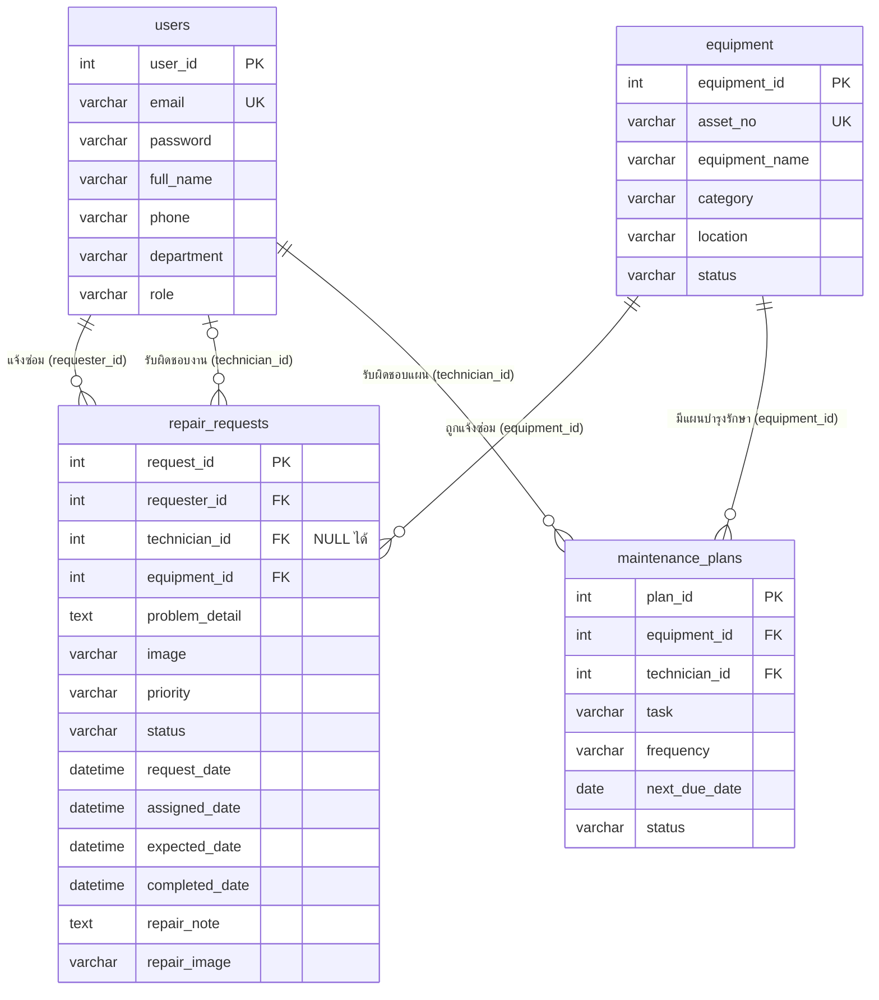
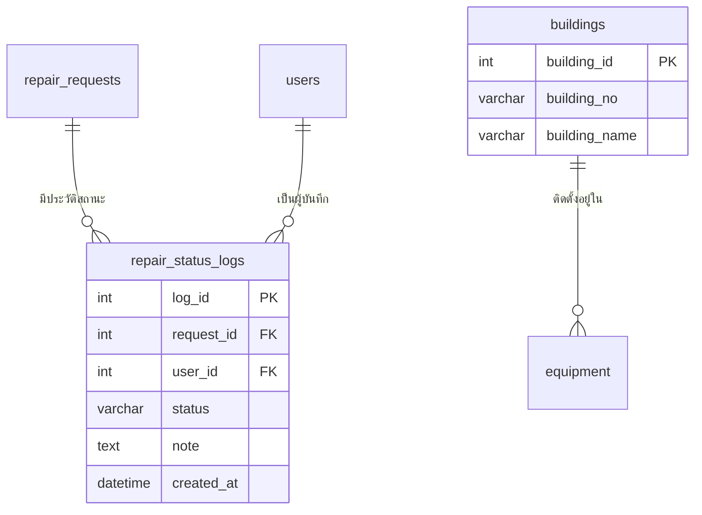

# เอกสารอธิบาย ERD — ระบบแจ้งซ่อมและบำรุงรักษา มหาวิทยาลัยรังสิต
### Entity Relationship Diagram & Data Dictionary

**วิชา CSC481** · อ้างอิงแผนภาพ [`erd fixed super final.png`](erd%20fixed%20super%20final.png)


---

## 📌 สารบัญ

1. [ภาพรวมของ ERD](#1-ภาพรวมของ-erd)
2. [Entity (ตาราง) ทั้งหมด](#2-entity-ตาราง-ทั้งหมด)
3. [Attribute ของแต่ละ Entity แบบละเอียด](#3-attribute-ของแต่ละ-entity-แบบละเอียด)
4. [Relationship (ความสัมพันธ์) ทั้งหมด](#4-relationship-ความสัมพันธ์-ทั้งหมด)
5. [การอ่านสัญลักษณ์ Crow's Foot](#5-การอ่านสัญลักษณ์-crows-foot)
6. [Data Dictionary — ค่าที่อนุญาตในแต่ละฟิลด์](#6-data-dictionary--ค่าที่อนุญาตในแต่ละฟิลด์)
7. [ข้อกำหนดความถูกต้องของข้อมูล (Integrity Constraints)](#7-ข้อกำหนดความถูกต้องของข้อมูล-integrity-constraints)
8. [ตัวอย่างข้อมูลในแต่ละตาราง](#8-ตัวอย่างข้อมูลในแต่ละตาราง)
9. [คำสั่ง SQL สร้างตาราง (DDL)](#9-คำสั่ง-sql-สร้างตาราง-ddl)
10. [ตัวอย่าง Query ที่ระบบใช้งานจริง](#10-ตัวอย่าง-query-ที่ระบบใช้งานจริง)
11. [การตรวจสอบ Normalization](#11-การตรวจสอบ-normalization)
12. [ERD เทียบกับการเก็บข้อมูลในระบบเดโม](#12-erd-เทียบกับการเก็บข้อมูลในระบบเดโม)

---

## 1. ภาพรวมของ ERD

| รายการ | จำนวน | รายละเอียด |
| :--- | :---: | :--- |
| Entity (ตาราง) | **4** | `users`, `equipment`, `repair_requests`, `maintenance_plans` |
| Attribute รวม | **34** | users 7 · equipment 6 · repair_requests 14 · maintenance_plans 7 |
| Primary Key | **4** | ทุกตารางมี PK แบบ Surrogate Key ชนิด `int` |
| Foreign Key | **5** | repair_requests 3 · maintenance_plans 2 |
| Unique Key | **2** | `users.email`, `equipment.asset_no` |
| Relationship | **5** | ทั้งหมดเป็นแบบ **1 : M (One-to-Many)** |



**แนวคิดการออกแบบโดยสรุป**
- `users` และ `equipment` เป็น **ข้อมูลหลัก (Master Data)** ที่ตารางอื่นอ้างอิง
- `repair_requests` เป็น **ตารางธุรกรรม (Transaction)** เกิดขึ้นทุกครั้งที่มีการแจ้งซ่อม — ซ่อมเมื่อพัง (Corrective Maintenance)
- `maintenance_plans` เป็น **ตารางแผนงาน** สำหรับดูแลก่อนพัง (Preventive Maintenance)
- ผู้แจ้ง ช่าง และแอดมิน อยู่ในตาราง `users` ตารางเดียว แยกด้วยฟิลด์ `role`

---

## 2. Entity (ตาราง) ทั้งหมด

| # | Entity | ประเภท | เก็บข้อมูลอะไร | Primary Key | ตัวอย่าง 1 แถว |
| :---: | :--- | :--- | :--- | :--- | :--- |
| 1 | `users` | Master | บุคลากรทุกคนที่ใช้ระบบ: เจ้าหน้าที่ (ผู้แจ้ง), ช่างเทคนิค, ผู้ดูแลระบบ | `user_id` | ธนากร ยั่งยืน — ช่างเทคนิค |
| 2 | `equipment` | Master | ครุภัณฑ์ทุกชิ้นที่ติดตั้งในอาคารต่าง ๆ ของมหาวิทยาลัย | `equipment_id` | AC-003 เครื่องปรับอากาศ 24,000 บีทียู |
| 3 | `repair_requests` | Transaction | ใบแจ้งซ่อม 1 ใบต่อปัญหา 1 ครั้ง ตั้งแต่แจ้งจนปิดงาน | `request_id` | แอร์ห้องประชุม 302 ไม่เย็น |
| 4 | `maintenance_plans` | Plan / Schedule | แผนบำรุงรักษาตามรอบของครุภัณฑ์แต่ละชิ้น | `plan_id` | ล้างแผงกรองแอร์ AC-001 ทุก 3 เดือน |

---

## 3. Attribute ของแต่ละ Entity แบบละเอียด

> **สัญลักษณ์:** **PK** = Primary Key · **FK** = Foreign Key · **UK** = Unique Key · **NN** = Not Null (ห้ามว่าง) · **N** = Nullable (ว่างได้)

### 3.1 `users` — ผู้ใช้งานและบุคลากร (7 attributes)

| # | Attribute | ชนิดข้อมูล | คีย์ | Null | ค่าที่อนุญาต / เงื่อนไข | ตัวอย่าง | คำอธิบาย |
| :---: | :--- | :--- | :---: | :---: | :--- | :--- | :--- |
| 1 | `user_id` | `int` | **PK** | NN | Auto Increment | `2` | รหัสผู้ใช้ ไม่ซ้ำ ใช้อ้างอิงจากตารางอื่น |
| 2 | `email` | `varchar(150)` | **UK** | NN | รูปแบบอีเมล, ห้ามซ้ำ | `thanakorn.y68@rsu.ac.th` | อีเมลสถาบัน ใช้เป็นชื่อเข้าสู่ระบบ |
| 3 | `password` | `varchar(255)` | | NN | อย่างน้อย 6 ตัวอักษร | `password123` | รหัสผ่าน (ระบบจริงเก็บเป็น Hash ความยาว 60+ ตัว จึงเผื่อไว้ 255) |
| 4 | `full_name` | `varchar(100)` | | NN | | `ธนากร ยั่งยืน` | ชื่อ - นามสกุล แสดงบนหน้าจอและ Timeline |
| 5 | `phone` | `varchar(30)` | | N | | `ต่อ 1206` | เบอร์ติดต่อ/เบอร์ต่อภายใน ใช้ยืนยันตัวตนตอนรีเซ็ตรหัสผ่าน |
| 6 | `department` | `varchar(100)` | | NN | | `สำนักงานอาคารและสิ่งแวดล้อม (ตึก 13)` | หน่วยงานต้นสังกัด |
| 7 | `role` | `varchar(30)` | | NN | `ผู้ดูแลระบบ`, `ช่างเทคนิค`, `เจ้าหน้าที่` | `ช่างเทคนิค` | บทบาท กำหนดสิทธิ์การเข้าถึงหน้าจอ |

### 3.2 `equipment` — ทะเบียนครุภัณฑ์ (6 attributes)

| # | Attribute | ชนิดข้อมูล | คีย์ | Null | ค่าที่อนุญาต / เงื่อนไข | ตัวอย่าง | คำอธิบาย |
| :---: | :--- | :--- | :---: | :---: | :--- | :--- | :--- |
| 1 | `equipment_id` | `int` | **PK** | NN | Auto Increment | `1` | รหัสภายในระบบ (Surrogate Key) |
| 2 | `asset_no` | `varchar(50)` | **UK** | NN | ห้ามซ้ำ | `AC-003` | เลขครุภัณฑ์ของมหาวิทยาลัย (Natural Key ที่คนใช้จริง) |
| 3 | `equipment_name` | `varchar(150)` | | NN | | `เครื่องปรับอากาศ 24,000 บีทียู` | ชื่อและคุณลักษณะ |
| 4 | `category` | `varchar(50)` | | NN | ดู [Data Dictionary](#6-data-dictionary--ค่าที่อนุญาตในแต่ละฟิลด์) | `ระบบปรับอากาศ` | หมวดหมู่ ใช้กรองและเลือกช่างที่เชี่ยวชาญ |
| 5 | `location` | `varchar(150)` | | NN | | `ห้องประชุม 302 · ชั้น 3` | สถานที่ติดตั้ง |
| 6 | `status` | `varchar(30)` | | NN | `ใช้งานปกติ`, `รอตรวจสอบ`, `อยู่ระหว่างซ่อม` | `อยู่ระหว่างซ่อม` | สถานะความพร้อมใช้งาน |

> ❓ **ทำไมมีทั้ง `equipment_id` และ `asset_no`?** — `asset_no` คือเลขที่คนใช้จริงและอาจเปลี่ยนได้ (เช่น เปลี่ยนระบบรหัสครุภัณฑ์) ถ้าใช้เป็น FK ต้องตามแก้ทุกตาราง จึงใช้ `equipment_id` เป็น PK ที่ไม่มีวันเปลี่ยน และบังคับให้ `asset_no` ไม่ซ้ำด้วย Unique Key

### 3.3 `repair_requests` — ใบแจ้งซ่อม (14 attributes)

| # | Attribute | ชนิดข้อมูล | คีย์ | Null | ค่าที่อนุญาต / เงื่อนไข | ตัวอย่าง | คำอธิบาย |
| :---: | :--- | :--- | :---: | :---: | :--- | :--- | :--- |
| 1 | `request_id` | `int` | **PK** | NN | Auto Increment | `1` | รหัสใบแจ้งซ่อม |
| 2 | `requester_id` | `int` | **FK** → `users.user_id` | NN | ต้องมีอยู่ใน `users` | `3` | ผู้แจ้งซ่อม |
| 3 | `technician_id` | `int` | **FK** → `users.user_id` | **N** | ต้องเป็นผู้ใช้ที่ `role = ช่างเทคนิค` | `2` | ช่างผู้รับผิดชอบ — **NULL = ยังไม่ได้มอบหมาย** |
| 4 | `equipment_id` | `int` | **FK** → `equipment.equipment_id` | NN | ต้องมีอยู่ใน `equipment` | `1` | ครุภัณฑ์ที่ชำรุด |
| 5 | `problem_detail` | `text` | | NN | | `เครื่องปรับอากาศไม่เย็น มีแต่ลมออก…` | รายละเอียดอาการ |
| 6 | `image` | `varchar(255)` | | N | | `แอร์ห้องประชุม302.jpg` | ไฟล์รูปหน้างานก่อนซ่อม (ผู้แจ้งแนบ) |
| 7 | `priority` | `varchar(20)` | | NN | `ต่ำ`, `ปกติ`, `เร่งด่วน` | `เร่งด่วน` | ระดับความสำคัญ |
| 8 | `status` | `varchar(30)` | | NN | `รอดำเนินการ`, `กำลังดำเนินการ`, `เสร็จสิ้น` · ค่าเริ่มต้น `รอดำเนินการ` | `กำลังดำเนินการ` | สถานะงาน |
| 9 | `request_date` | `datetime` | | NN | ค่าเริ่มต้น = เวลาปัจจุบัน | `2026-10-28 08:45` | เวลาที่แจ้ง |
| 10 | `assigned_date` | `datetime` | | N | ≥ `request_date` | `2026-10-28 09:00` | เวลาที่แอดมินมอบหมายช่าง |
| 11 | `expected_date` | `datetime` | | N | | `2026-10-28 12:00` | เวลาที่ช่างคาดว่าจะเสร็จ (ETA) |
| 12 | `completed_date` | `datetime` | | N | ต้องมีค่าเมื่อ `status = เสร็จสิ้น` | `NULL` | เวลาที่ปิดงาน |
| 13 | `repair_note` | `text` | | N | | `ตรวจพบสารทำความเย็นรั่ว…` | บันทึกสาเหตุและวิธีแก้ของช่าง |
| 14 | `repair_image` | `varchar(255)` | | N | | `NULL` | ไฟล์หลักฐานหลังซ่อม (ช่างแนบ) |

> 📌 ฟิลด์วันที่ 4 ตัวสอดคล้องกับ Timeline 4 ขั้นในหน้าติดตามงาน: `request_date` (ขั้น 1) → `assigned_date` (ขั้น 2) → `expected_date` (ขั้น 3, ETA) → `completed_date` (ขั้น 4)

### 3.4 `maintenance_plans` — แผนบำรุงรักษาเชิงป้องกัน (7 attributes)

| # | Attribute | ชนิดข้อมูล | คีย์ | Null | ค่าที่อนุญาต / เงื่อนไข | ตัวอย่าง | คำอธิบาย |
| :---: | :--- | :--- | :---: | :---: | :--- | :--- | :--- |
| 1 | `plan_id` | `int` | **PK** | NN | Auto Increment | `1` | รหัสแผน |
| 2 | `equipment_id` | `int` | **FK** → `equipment.equipment_id` | NN | | `8` | ครุภัณฑ์ที่ต้องบำรุงรักษา |
| 3 | `technician_id` | `int` | **FK** → `users.user_id` | NN | `role` = ช่างเทคนิค หรือ ผู้ดูแลระบบ | `2` | ผู้รับผิดชอบแผน |
| 4 | `task` | `varchar(150)` | | NN | | `ล้างแผงกรอง / ตรวจน้ำยา` | รายการงานที่ต้องทำ |
| 5 | `frequency` | `varchar(50)` | | NN | `ทุก 1 เดือน`, `ทุก 3 เดือน`, `ทุก 6 เดือน`, `ทุก 1 ปี` | `ทุก 3 เดือน` | รอบการดูแล |
| 6 | `next_due_date` | `date` | | NN | | `2026-10-27` | กำหนดครั้งถัดไป |
| 7 | `status` | `varchar(30)` | | NN | `รอดำเนินการ`, `ใกล้ครบกำหนด`, `เกินกำหนด` | `เกินกำหนด` | สถานะแผน (ในระบบคำนวณจาก `next_due_date` เทียบกับวันนี้) |

---

## 4. Relationship (ความสัมพันธ์) ทั้งหมด

| # | ชื่อความสัมพันธ์ | ตารางแม่ (1) | ตารางลูก (M) | FK ที่เชื่อม | Cardinality | Participation (ฝั่งลูก) | อธิบาย |
| :---: | :--- | :--- | :--- | :--- | :---: | :--- | :--- |
| R1 | **แจ้งซ่อม** (submits) | `users` | `repair_requests` | `requester_id` | 1 : M | **บังคับ** — ใบแจ้งซ่อมทุกใบต้องมีผู้แจ้ง | ผู้ใช้ 1 คนแจ้งได้ 0..N ใบ · ใบแจ้ง 1 ใบมีผู้แจ้ง 1 คนเท่านั้น |
| R2 | **รับผิดชอบงานซ่อม** (handles) | `users` | `repair_requests` | `technician_id` | 1 : M | **ไม่บังคับ** — ว่างได้ระหว่างรอมอบหมาย | ช่าง 1 คนรับได้ 0..N ใบ · ใบแจ้ง 1 ใบมีช่าง 0..1 คน |
| R3 | **ถูกแจ้งซ่อม** (is reported in) | `equipment` | `repair_requests` | `equipment_id` | 1 : M | **บังคับ** — ต้องระบุครุภัณฑ์ทุกครั้ง | ครุภัณฑ์ 1 ชิ้นถูกแจ้งได้ 0..N ครั้ง · ใบแจ้ง 1 ใบเป็นของครุภัณฑ์ 1 ชิ้น |
| R4 | **มีแผนบำรุงรักษา** (has) | `equipment` | `maintenance_plans` | `equipment_id` | 1 : M | **บังคับ** | ครุภัณฑ์ 1 ชิ้นมีได้ 0..N แผน (เช่น ล้างแอร์ + ตรวจน้ำยา) · แผน 1 แผนเป็นของครุภัณฑ์ 1 ชิ้น |
| R5 | **รับผิดชอบแผน** (is assigned) | `users` | `maintenance_plans` | `technician_id` | 1 : M | **บังคับ** — แผนต้องมีผู้รับผิดชอบเสมอ | ช่าง 1 คนดูแลได้ 0..N แผน · แผน 1 แผนมีผู้รับผิดชอบ 1 คน |

### เขียนแบบ (min, max)

| ความสัมพันธ์ | ฝั่งตารางแม่ | ฝั่งตารางลูก | อ่านว่า |
| :--- | :---: | :---: | :--- |
| R1 users — repair_requests (ผู้แจ้ง) | (1, 1) | (0, N) | ใบแจ้งซ่อมต้องมีผู้แจ้ง **1 คนพอดี** · ผู้ใช้แจ้ง **ไม่แจ้งเลย ถึงหลายใบ** |
| R2 users — repair_requests (ช่าง) | (0, 1) | (0, N) | ใบแจ้งซ่อมมีช่าง **ไม่มี หรือ 1 คน** · ช่างรับงาน **0 ถึงหลายใบ** |
| R3 equipment — repair_requests | (1, 1) | (0, N) | ใบแจ้งซ่อมต้องระบุครุภัณฑ์ **1 ชิ้นพอดี** · ครุภัณฑ์ถูกแจ้ง **0 ถึงหลายครั้ง** |
| R4 equipment — maintenance_plans | (1, 1) | (0, N) | แผนต้องเป็นของครุภัณฑ์ **1 ชิ้นพอดี** · ครุภัณฑ์มีแผน **0 ถึงหลายแผน** |
| R5 users — maintenance_plans | (1, 1) | (0, N) | แผนต้องมีผู้รับผิดชอบ **1 คนพอดี** · ช่างดูแล **0 ถึงหลายแผน** |

### ทำไมไม่มีความสัมพันธ์แบบ M : N?
- ใบแจ้งซ่อม 1 ใบผูกกับครุภัณฑ์ **1 ชิ้น** และช่าง **1 คน** ตามขั้นตอนจริงของฝ่ายอาคารฯ (ถ้าพังหลายชิ้นก็แจ้งแยกใบ เพื่อติดตามและปิดงานได้ทีละชิ้น)
- ถ้าอนาคตต้องให้ช่างหลายคนช่วยกันซ่อมงานเดียว จะเพิ่มตารางกลาง `repair_assignments (request_id, technician_id)` เพื่อแตก M : N ออกเป็น 1 : M สองเส้น

---

## 5. การอ่านสัญลักษณ์ Crow's Foot

| สัญลักษณ์ | ชื่อ | ความหมาย | ใช้ที่ไหนใน ERD นี้ |
| :---: | :--- | :--- | :--- |
| `\|\|` | One and only one | 1 พอดี (บังคับ) | ฝั่ง `users` ของ R1, R5 · ฝั่ง `equipment` ของ R3, R4 |
| `o\|` | Zero or one | 0 หรือ 1 (ไม่บังคับ) | ฝั่ง `users` ของ R2 (ช่างของใบแจ้งซ่อม) |
| `o{` | Zero or many | 0 ถึงหลาย | ฝั่ง `repair_requests` และ `maintenance_plans` ทุกเส้น |
| `\|{` | One or many | 1 ถึงหลาย (บังคับ) | ไม่ได้ใช้ — เพราะผู้ใช้หรือครุภัณฑ์ใหม่ยังไม่มีใบแจ้งซ่อม/แผนได้ |

---

## 6. Data Dictionary — ค่าที่อนุญาตในแต่ละฟิลด์

| ฟิลด์ | ค่าที่อนุญาต | ความหมาย |
| :--- | :--- | :--- |
| `users.role` | `เจ้าหน้าที่` | อาจารย์/บุคลากร แจ้งซ่อมและติดตามงาน |
| | `ช่างเทคนิค` | รับงานซ่อมและทำงานตามแผนบำรุงรักษา |
| | `ผู้ดูแลระบบ` | มอบหมายช่าง จัดการครุภัณฑ์และแผนบำรุงรักษา |
| `equipment.category` | `ระบบปรับอากาศ` · `อุปกรณ์สำนักงาน` · `ระบบไฟฟ้า` · `ระบบประปา` · `คอมพิวเตอร์` · `อาคารและสถานที่` | หมวดหมู่ครุภัณฑ์ |
| `equipment.status` | `ใช้งานปกติ` | ไม่มีใบแจ้งซ่อมค้าง |
| | `รอตรวจสอบ` | มีใบแจ้งซ่อมที่ยังไม่เริ่มซ่อม |
| | `อยู่ระหว่างซ่อม` | มีใบแจ้งซ่อมที่กำลังดำเนินการ |
| `repair_requests.priority` | `ต่ำ` | ไม่กระทบการใช้งาน |
| | `ปกติ` | กระทบการใช้งานบางส่วน |
| | `เร่งด่วน` | กระทบการให้บริการ ต้องทำก่อน |
| `repair_requests.status` | `รอดำเนินการ` | แจ้งแล้ว รอมอบหมาย หรือมอบหมายแล้วแต่ช่างยังไม่เริ่ม |
| | `กำลังดำเนินการ` | ช่างกำลังซ่อม |
| | `เสร็จสิ้น` | ปิดงานแล้ว |
| `maintenance_plans.frequency` | `ทุก 1 เดือน` · `ทุก 3 เดือน` · `ทุก 6 เดือน` · `ทุก 1 ปี` | รอบการดูแล |
| `maintenance_plans.status` | `รอดำเนินการ` | ยังไม่ถึงกำหนด (เหลือมากกว่า 7 วัน) |
| | `ใกล้ครบกำหนด` | เหลือไม่เกิน 7 วัน |
| | `เกินกำหนด` | เลยกำหนดแล้วแต่ยังไม่ได้ทำ |

---

## 7. ข้อกำหนดความถูกต้องของข้อมูล (Integrity Constraints)

| ประเภท | กฎ | บังคับด้วย |
| :--- | :--- | :--- |
| **Entity Integrity** | PK ทุกตารางห้ามว่างและห้ามซ้ำ | `PRIMARY KEY` |
| **Referential Integrity** | FK ต้องชี้ไปยังแถวที่มีอยู่จริง | `FOREIGN KEY … REFERENCES` |
| **Unique** | อีเมลผู้ใช้ห้ามซ้ำ · เลขครุภัณฑ์ห้ามซ้ำ | `UNIQUE` |
| **Domain** | ฟิลด์สถานะ/บทบาท/ความสำคัญ/รอบดูแล ใช้ได้เฉพาะค่าในหัวข้อ 6 | `CHECK (… IN (…))` |
| **Business Rule** | งานที่ `เสร็จสิ้น` ต้องมี `completed_date` | `CHECK` |
| **Business Rule** | งานที่ `กำลังดำเนินการ` หรือ `เสร็จสิ้น` ต้องมีช่าง (`technician_id` ไม่ว่าง) | `CHECK` |
| **Business Rule** | วันที่มอบหมาย/ปิดงาน ต้องไม่ก่อนวันที่แจ้ง | `CHECK` |

### เมื่อลบข้อมูลในตารางแม่ (ON DELETE)

| FK | นโยบาย | เหตุผล |
| :--- | :--- | :--- |
| `repair_requests.requester_id` | `RESTRICT` | ห้ามลบผู้ใช้ที่เคยแจ้งซ่อม เพื่อเก็บประวัติไว้ตรวจสอบ |
| `repair_requests.technician_id` | `SET NULL` | ถ้าช่างลาออก ใบงานที่ยังไม่เริ่มกลับเป็น "รอมอบหมาย" ให้แอดมินมอบหมายใหม่ · ถ้ายังมีงาน "กำลังดำเนินการ" ค้างอยู่ `chk_started_has_tech` จะไม่ยอมให้ลบ ต้องโอนงานให้ช่างคนอื่นก่อน |
| `repair_requests.equipment_id` | `RESTRICT` | ห้ามลบครุภัณฑ์ที่มีประวัติซ่อม (ใช้การเปลี่ยนสถานะแทน) |
| `maintenance_plans.equipment_id` | `CASCADE` | ครุภัณฑ์ถูกตัดออกจากทะเบียน แผนของมันก็ไม่มีความหมายแล้ว |
| `maintenance_plans.technician_id` | `RESTRICT` | ต้องโอนแผนให้ช่างคนอื่นก่อนลบผู้ใช้ |

---

## 8. ตัวอย่างข้อมูลในแต่ละตาราง

ข้อมูลตั้งต้นของระบบ (จาก `js/data.js`) แสดงบางส่วน

**`users`** (5 แถว)

| user_id | email | full_name | phone | department | role |
| :---: | :--- | :--- | :--- | :--- | :--- |
| 1 | naphatcharakan.p68@rsu.ac.th | ณพัชรกัณฑ์ พัชญ์ชัยพงศา | ต่อ 1302 | วิทยาลัยนวัตกรรมดิจิทัลเทคโนโลยี | ผู้ดูแลระบบ |
| 2 | thanakorn.y68@rsu.ac.th | ธนากร ยั่งยืน | ต่อ 1206 | สำนักงานอาคารและสิ่งแวดล้อม (ตึก 13) | ช่างเทคนิค |
| 3 | sorawit.t68@rsu.ac.th | สรวิชญ์ ทองพลับ | ต่อ 1305 | วิทยาลัยนวัตกรรมดิจิทัลเทคโนโลยี | เจ้าหน้าที่ |
| 4 | naphat.s68@rsu.ac.th | ณภัทร สาระคำ | ต่อ 1208 | สำนักงานอาคารและสิ่งแวดล้อม (ตึก 13) | ช่างเทคนิค |
| 5 | chartwut.t68@rsu.ac.th | ชาติวุฒิ ทองจีน | ต่อ 1201 | สำนักงานอาคารและสิ่งแวดล้อม (ตึก 13) | ผู้ดูแลระบบ |

**`equipment`** (4 จาก 8 แถว)

| equipment_id | asset_no | equipment_name | category | location | status |
| :---: | :--- | :--- | :--- | :--- | :--- |
| 1 | AC-003 | เครื่องปรับอากาศ 24,000 บีทียู | ระบบปรับอากาศ | ห้องประชุม 302 · ชั้น 3 | อยู่ระหว่างซ่อม |
| 2 | PR-012 | เครื่องพิมพ์เลเซอร์ | อุปกรณ์สำนักงาน | สำนักทะเบียน · ชั้น 1 | รอตรวจสอบ |
| 3 | EL-021 | ชุดโคมไฟทางเดิน LED | ระบบไฟฟ้า | โถงทางเดิน · ชั้น 2 | อยู่ระหว่างซ่อม |
| 4 | PL-008 | ชุดก๊อกน้ำอ่างล้างมือ | ระบบประปา | ห้องน้ำ · ชั้น 1 | ใช้งานปกติ |

**`repair_requests`** (3 จาก 7 แถว — แสดงให้เห็นทั้ง 3 สถานะ)

| request_id | requester_id | technician_id | equipment_id | priority | status | request_date | assigned_date | completed_date |
| :---: | :---: | :---: | :---: | :--- | :--- | :--- | :--- | :--- |
| 1 | 3 | 2 | 1 | เร่งด่วน | กำลังดำเนินการ | 2026-10-28 08:45 | 2026-10-28 09:00 | NULL |
| 2 | 1 | **NULL** | 2 | ปกติ | รอดำเนินการ | 2026-10-28 08:30 | NULL | NULL |
| 4 | 1 | 4 | 4 | ปกติ | เสร็จสิ้น | 2026-10-27 14:20 | 2026-10-27 14:40 | 2026-10-27 16:30 |

> แถว `request_id = 2` คือตัวอย่างที่ `technician_id` เป็น NULL (ยังไม่มอบหมาย) ตามความสัมพันธ์ R2 แบบไม่บังคับ

**`maintenance_plans`** (3 จาก 7 แถว)

| plan_id | equipment_id | technician_id | task | frequency | next_due_date |
| :---: | :---: | :---: | :--- | :--- | :--- |
| 1 | 8 | 2 | ล้างแผงกรอง / ตรวจน้ำยา | ทุก 3 เดือน | 2026-10-27 |
| 4 | 2 | 5 | ทำความสะอาด / ทดสอบพิมพ์ | ทุก 6 เดือน | 2026-11-03 |
| 7 | 4 | 4 | ตรวจรอยรั่วและวาล์วน้ำ | ทุก 3 เดือน | 2026-11-10 |

---

## 9. คำสั่ง SQL สร้างตาราง (DDL)

เขียนสำหรับ **MySQL 8.0** สร้างตามลำดับ: ตารางแม่ก่อน (`users`, `equipment`) แล้วจึงตารางลูก

```sql
CREATE TABLE users (
  user_id     INT AUTO_INCREMENT PRIMARY KEY,
  email       VARCHAR(150) NOT NULL UNIQUE,
  password    VARCHAR(255) NOT NULL,
  full_name   VARCHAR(100) NOT NULL,
  phone       VARCHAR(30),
  department  VARCHAR(100) NOT NULL,
  role        VARCHAR(30)  NOT NULL
              CHECK (role IN ('ผู้ดูแลระบบ', 'ช่างเทคนิค', 'เจ้าหน้าที่'))
);

CREATE TABLE equipment (
  equipment_id    INT AUTO_INCREMENT PRIMARY KEY,
  asset_no        VARCHAR(50)  NOT NULL UNIQUE,
  equipment_name  VARCHAR(150) NOT NULL,
  category        VARCHAR(50)  NOT NULL,
  location        VARCHAR(150) NOT NULL,
  status          VARCHAR(30)  NOT NULL DEFAULT 'ใช้งานปกติ'
                  CHECK (status IN ('ใช้งานปกติ', 'รอตรวจสอบ', 'อยู่ระหว่างซ่อม'))
);

CREATE TABLE repair_requests (
  request_id      INT AUTO_INCREMENT PRIMARY KEY,
  requester_id    INT NOT NULL,
  technician_id   INT NULL,
  equipment_id    INT NOT NULL,
  problem_detail  TEXT NOT NULL,
  image           VARCHAR(255),
  priority        VARCHAR(20) NOT NULL DEFAULT 'ปกติ'
                  CHECK (priority IN ('ต่ำ', 'ปกติ', 'เร่งด่วน')),
  status          VARCHAR(30) NOT NULL DEFAULT 'รอดำเนินการ'
                  CHECK (status IN ('รอดำเนินการ', 'กำลังดำเนินการ', 'เสร็จสิ้น')),
  request_date    DATETIME NOT NULL DEFAULT CURRENT_TIMESTAMP,
  assigned_date   DATETIME,
  expected_date   DATETIME,
  completed_date  DATETIME,
  repair_note     TEXT,
  repair_image    VARCHAR(255),

  CONSTRAINT fk_request_requester  FOREIGN KEY (requester_id)  REFERENCES users(user_id)          ON DELETE RESTRICT,
  CONSTRAINT fk_request_technician FOREIGN KEY (technician_id) REFERENCES users(user_id)          ON DELETE SET NULL,
  CONSTRAINT fk_request_equipment  FOREIGN KEY (equipment_id)  REFERENCES equipment(equipment_id) ON DELETE RESTRICT,

  CONSTRAINT chk_done_has_date     CHECK (status <> 'เสร็จสิ้น' OR completed_date IS NOT NULL),
  CONSTRAINT chk_started_has_tech  CHECK (status = 'รอดำเนินการ' OR technician_id IS NOT NULL),
  CONSTRAINT chk_assigned_order    CHECK (assigned_date  IS NULL OR assigned_date  >= request_date),
  CONSTRAINT chk_completed_order   CHECK (completed_date IS NULL OR completed_date >= request_date)
);

CREATE TABLE maintenance_plans (
  plan_id        INT AUTO_INCREMENT PRIMARY KEY,
  equipment_id   INT NOT NULL,
  technician_id  INT NOT NULL,
  task           VARCHAR(150) NOT NULL,
  frequency      VARCHAR(50)  NOT NULL
                 CHECK (frequency IN ('ทุก 1 เดือน', 'ทุก 3 เดือน', 'ทุก 6 เดือน', 'ทุก 1 ปี')),
  next_due_date  DATE NOT NULL,
  status         VARCHAR(30) NOT NULL DEFAULT 'รอดำเนินการ'
                 CHECK (status IN ('รอดำเนินการ', 'ใกล้ครบกำหนด', 'เกินกำหนด')),

  CONSTRAINT fk_plan_equipment  FOREIGN KEY (equipment_id)  REFERENCES equipment(equipment_id) ON DELETE CASCADE,
  CONSTRAINT fk_plan_technician FOREIGN KEY (technician_id) REFERENCES users(user_id)          ON DELETE RESTRICT
);
```

> กฎ "`technician_id` ต้องเป็นผู้ใช้ที่ role = ช่างเทคนิค" อ้างอิงข้ามตาราง ใช้ `CHECK` ไม่ได้ ต้องตรวจที่ระดับโปรแกรม (ระบบตรวจตอนมอบหมายงาน — รายชื่อในหน้าต่างมอบหมายมีเฉพาะช่างเทคนิค) หรือใช้ Trigger

---

## 10. ตัวอย่าง Query ที่ระบบใช้งานจริง

**Q1 — หน้าภาพรวม: รายการแจ้งซ่อมพร้อมชื่อผู้แจ้ง ชื่อช่าง และครุภัณฑ์**
JOIN `users` 2 ครั้งด้วยชื่อแฝงคนละตัว เพราะมี FK ไปที่ `users` 2 เส้น และใช้ `LEFT JOIN` กับช่าง เพราะงานที่ยังไม่มอบหมายมี `technician_id` เป็น NULL

```sql
SELECT r.request_id, e.asset_no, e.equipment_name, r.priority, r.status,
       req.full_name                         AS requester,
       COALESCE(tech.full_name, 'รอมอบหมาย') AS technician,
       r.request_date
FROM repair_requests r
JOIN      equipment e    ON e.equipment_id = r.equipment_id
JOIN      users     req  ON req.user_id    = r.requester_id
LEFT JOIN users     tech ON tech.user_id   = r.technician_id
ORDER BY r.request_date DESC;
```

**Q2 — ตัวเลขสถิติบน Dashboard**
```sql
SELECT status, COUNT(*) AS total
FROM repair_requests
GROUP BY status;
```

**Q3 — หน้างานของช่าง: งานที่มอบหมายให้ช่างคนที่ล็อกอิน (เช่น user_id = 2)**
```sql
SELECT r.request_id, e.asset_no, r.priority, r.status, r.expected_date
FROM repair_requests r
JOIN equipment e ON e.equipment_id = r.equipment_id
WHERE r.technician_id = 2
ORDER BY r.status = 'เสร็จสิ้น', r.priority = 'เร่งด่วน' DESC, r.request_date;
```

**Q4 — ทะเบียนครุภัณฑ์: ประวัติการซ่อมของครุภัณฑ์ 1 ชิ้น**
```sql
SELECT r.request_id, r.request_date, r.status, r.repair_note
FROM repair_requests r
WHERE r.equipment_id = (SELECT equipment_id FROM equipment WHERE asset_no = 'PL-008')
ORDER BY r.request_date DESC;
```

**Q5 — แผนบำรุงรักษา: งานที่เกินกำหนดและใกล้ครบกำหนด (คำนวณจากวันนี้)**
```sql
SELECT p.plan_id, e.asset_no, p.task, p.next_due_date, u.full_name AS responsible,
       CASE
         WHEN p.next_due_date < CURRENT_DATE                            THEN 'เกินกำหนด'
         WHEN p.next_due_date <= CURRENT_DATE + INTERVAL 7 DAY          THEN 'ใกล้ครบกำหนด'
         ELSE 'รอดำเนินการ'
       END AS plan_status
FROM maintenance_plans p
JOIN equipment e ON e.equipment_id = p.equipment_id
JOIN users     u ON u.user_id      = p.technician_id
ORDER BY p.next_due_date;
```

**Q6 — มอบหมายช่าง (หน้าภาพรวม ปุ่ม "มอบหมาย")**
```sql
UPDATE repair_requests
SET technician_id = 4, assigned_date = NOW()
WHERE request_id = 2 AND status <> 'เสร็จสิ้น';
```

---

## 11. การตรวจสอบ Normalization

### Functional Dependency ของแต่ละตาราง

| ตาราง | Functional Dependency |
| :--- | :--- |
| `users` | `user_id → email, password, full_name, phone, department, role` · `email → user_id` (Candidate Key) |
| `equipment` | `equipment_id → asset_no, equipment_name, category, location, status` · `asset_no → equipment_id` (Candidate Key) |
| `repair_requests` | `request_id → requester_id, technician_id, equipment_id, problem_detail, image, priority, status, request_date, assigned_date, expected_date, completed_date, repair_note, repair_image` |
| `maintenance_plans` | `plan_id → equipment_id, technician_id, task, frequency, next_due_date, status` |

### ผ่านแต่ละระดับอย่างไร

| ระดับ | เงื่อนไข | ผลตรวจ ERD นี้ |
| :---: | :--- | :--- |
| **1NF** | ทุกฟิลด์เป็นค่าเดี่ยว (Atomic) ไม่มีกลุ่มข้อมูลซ้ำ | ✅ ไม่มีฟิลด์เก็บหลายค่า เช่น ใบแจ้งซ่อมเก็บครุภัณฑ์ 1 ชิ้นและช่าง 1 คน |
| **2NF** | ผ่าน 1NF และไม่มี Partial Dependency | ✅ ทุกตารางใช้ PK คอลัมน์เดียว จึงไม่มีทางเกิด Partial Dependency |
| **3NF** | ผ่าน 2NF และไม่มี Transitive Dependency (ฟิลด์ทั่วไปขึ้นกับ PK โดยตรงเท่านั้น) | ✅ ข้อมูลผู้ใช้ (ชื่อ, เบอร์, หน่วยงาน) และข้อมูลครุภัณฑ์ (ชื่อ, หมวด, สถานที่) ไม่ได้เก็บซ้ำใน `repair_requests` แต่แยกไปอยู่ตารางของตัวเองและอ้างอิงด้วย FK |

### ตัวอย่างถ้า **ไม่** แยกตาราง (ทำไมต้องออกแบบแบบนี้)

ถ้าเก็บทุกอย่างในตารางเดียว:

| request_id | requester_name | requester_phone | asset_no | equipment_name | location | status |
| :---: | :--- | :--- | :--- | :--- | :--- | :--- |
| 1 | สรวิชญ์ ทองพลับ | ต่อ 1305 | AC-003 | เครื่องปรับอากาศ 24,000 บีทียู | ห้องประชุม 302 | กำลังดำเนินการ |
| 7 | สรวิชญ์ ทองพลับ | ต่อ 1305 | AC-004 | เครื่องปรับอากาศ 18,000 บีทียู | ห้อง 305 | รอดำเนินการ |

- `request_id → asset_no → equipment_name, location` คือ **Transitive Dependency** (ผิด 3NF)
- **Update Anomaly:** ย้ายแอร์ AC-003 ไปห้องอื่น ต้องแก้ทุกแถวที่เคยแจ้งซ่อม
- **Insert Anomaly:** เพิ่มครุภัณฑ์ใหม่ไม่ได้ ถ้ายังไม่เคยถูกแจ้งซ่อม
- **Delete Anomaly:** ลบใบแจ้งซ่อมใบสุดท้ายของครุภัณฑ์ ข้อมูลครุภัณฑ์หายไปด้วย

การแยกเป็น `users`, `equipment`, `repair_requests` ตาม ERD นี้แก้ทั้ง 3 ปัญหา

---

## 12. ERD เทียบกับการเก็บข้อมูลในระบบเดโม

ระบบเดโมเป็นเว็บที่ไม่มีเซิร์ฟเวอร์ จึงเก็บข้อมูลใน LocalStorage ของเบราว์เซอร์ โครงสร้างหลักตรงกับ ERD ทุกตาราง และมีฟิลด์เสริมเพื่อแสดงผล:

| ตารางใน ERD | ชื่อที่เก็บใน LocalStorage | ฟิลด์ตาม ERD | ฟิลด์เสริมเพื่อแสดงผล | ถ้าทำฐานข้อมูลจริง |
| :--- | :--- | :---: | :--- | :--- |
| `users` | `users` | ✅ ครบ | `student_id`, `title_role`, `avatar` | เพิ่ม `student_id`, `title_role` เป็นคอลัมน์ได้ · `avatar` คำนวณจากชื่อ |
| `equipment` | `equipment` | ✅ ครบ | `building`, `location_full` | แยกเป็นตาราง `buildings` แล้วให้ `equipment` อ้างอิงด้วย FK |
| `repair_requests` | `repairs` | ✅ ครบ | `ticket_no`, `problem_title`, `location_text`, `timeline` | `ticket_no`, `problem_title` เป็นคอลัมน์ได้ · `timeline` แยกเป็นตาราง `repair_status_logs` |
| `maintenance_plans` | `plans` | ✅ ครบ | `code`, `equipment_name`, `technician_name`, `location`, `last_done_date` | ชื่อและสถานที่ JOIN จาก FK แทนการเก็บซ้ำ · `code`, `last_done_date` เป็นคอลัมน์ได้ |

### แนวทางขยาย ERD ในอนาคต



- `repair_status_logs` — เก็บทุกครั้งที่สถานะงานเปลี่ยน (แทน `timeline` ในเดโม) ตรวจสอบย้อนหลังได้ว่าใครทำอะไรเมื่อไร
- `buildings` — แยกข้อมูลอาคารออกจาก `equipment.location` ลดการพิมพ์ชื่ออาคารซ้ำ และกรองครุภัณฑ์ตามอาคารได้ถูกต้อง
