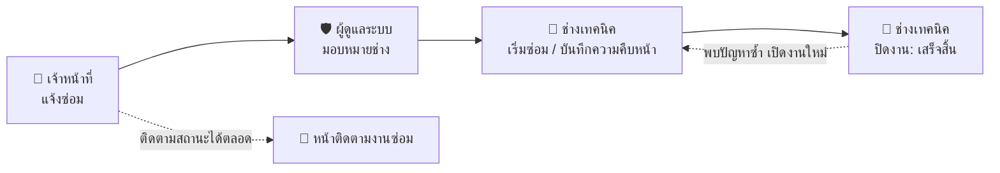
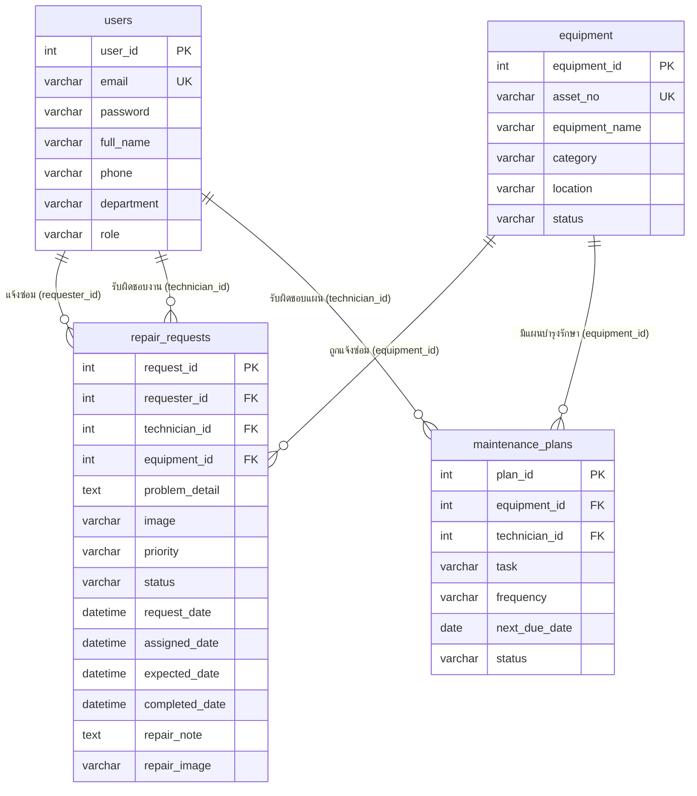

# เอกสารระบบแจ้งซ่อมและบำรุงรักษา มหาวิทยาลัยรังสิต
### RSU Smart Repair & Maintenance System — System Documentation

**วิชา CSC481** · วิทยาลัยนวัตกรรมดิจิทัลเทคโนโลยี (DIT) ร่วมกับสำนักงานอาคารและสิ่งแวดล้อม (ตึก 13) · มหาวิทยาลัยรังสิต

---

## 📌 สารบัญ

1. [ภาพรวมระบบและผู้ใช้งาน](#1-ภาพรวมระบบและผู้ใช้งาน)
2. [ขั้นตอนการทำงานของระบบ (Workflow)](#2-ขั้นตอนการทำงานของระบบ-workflow)
3. [สคริปต์เดโมสำหรับการนำเสนอ](#3-สคริปต์เดโมสำหรับการนำเสนอ)
4. [การออกแบบฐานข้อมูล (ERD)](#4-การออกแบบฐานข้อมูล-erd)
5. [กฎทางธุรกิจที่ระบบคำนวณให้อัตโนมัติ](#5-กฎทางธุรกิจที่ระบบคำนวณให้อัตโนมัติ)
6. [แนวทางตอบคำถามอาจารย์](#6-แนวทางตอบคำถามอาจารย์)
7. [ข้อจำกัดและแนวทางพัฒนาต่อ](#7-ข้อจำกัดและแนวทางพัฒนาต่อ)
8. [การแก้ปัญหาเบื้องต้นและการ Deploy](#8-การแก้ปัญหาเบื้องต้นและการ-deploy)

---

## 1. ภาพรวมระบบและผู้ใช้งาน

ระบบเว็บแอปพลิเคชันสำหรับรับแจ้งซ่อมครุภัณฑ์ภายในมหาวิทยาลัยรังสิต ช่วยให้ผู้แจ้ง หัวหน้าฝ่ายอาคารฯ และช่างเทคนิค ทำงานบนข้อมูลชุดเดียวกัน ตั้งแต่แจ้งปัญหาจนปิดงาน รวมถึงวางแผนบำรุงรักษาเชิงป้องกันก่อนอุปกรณ์จะชำรุด

### ผู้ใช้งาน 3 บทบาท

| บทบาท | ใครเป็นผู้ใช้ | หน้าที่หลักในระบบ | หน้าแรกหลังล็อกอิน |
| :--- | :--- | :--- | :--- |
| 📝 **เจ้าหน้าที่** | อาจารย์ / บุคลากรของคณะ | แจ้งซ่อม และติดตามสถานะงาน | ภาพรวมงานซ่อม |
| 🔧 **ช่างเทคนิค** | ช่างประจำอาคาร ฝ่ายอาคารฯ ตึก 13 | รับงาน อัปเดตความคืบหน้า บันทึกผลการซ่อม และทำงานบำรุงรักษาตามแผน | งานที่ได้รับมอบหมาย |
| 🛡️ **ผู้ดูแลระบบ** | หัวหน้าฝ่ายอาคารฯ ตึก 13 | มอบหมายช่าง จัดการทะเบียนครุภัณฑ์ และวางแผนบำรุงรักษา | ภาพรวมงานซ่อม |

### บัญชีสมาชิกกลุ่ม (ใช้เดโม)

| ลำดับ | รหัสนักศึกษา | ชื่อ - นามสกุล | อีเมล | รหัสผ่าน | บทบาท | หน่วยงาน |
| :---: | :---: | :--- | :--- | :---: | :--- | :--- |
| 1 | 6800401 | ณพัชรกัณฑ์ พัชญ์ชัยพงศา | `naphatcharakan.p68@rsu.ac.th` | `admin123` | 🛡️ ผู้ดูแลระบบหลัก | วิทยาลัยนวัตกรรมดิจิทัลเทคโนโลยี |
| 2 | 6803317 | ธนากร ยั่งยืน | `thanakorn.y68@rsu.ac.th` | `password123` | 🔧 ช่างระบบปรับอากาศ (ตึก 1-5) | สำนักงานอาคารและสิ่งแวดล้อม (ตึก 13) |
| 3 | 6803162 | สรวิชญ์ ทองพลับ | `sorawit.t68@rsu.ac.th` | `password123` | 📝 เจ้าหน้าที่ (ผู้แจ้งซ่อม) | วิทยาลัยนวัตกรรมดิจิทัลเทคโนโลยี |
| 4 | 6803498 | ณภัทร สาระคำ | `naphat.s68@rsu.ac.th` | `password123` | 🔧 ช่างระบบไฟฟ้าและประปา (ตึก 6-12) | สำนักงานอาคารและสิ่งแวดล้อม (ตึก 13) |
| 5 | 6804265 | ชาติวุฒิ ทองจีน | `chartwut.t68@rsu.ac.th` | `password123` | 🛡️ ผู้ดูแลระบบ (หัวหน้าฝ่ายอาคารฯ) | สำนักงานอาคารและสิ่งแวดล้อม (ตึก 13) |

> 💡 ที่หน้า Login กดปุ่มชื่อสมาชิกเพื่อกรอกอีเมล/รหัสผ่านให้อัตโนมัติ ถ้าจะสลับไปดูอีกบทบาท ให้ **ออกจากระบบ** แล้วล็อกอินด้วยบัญชีนั้น

### หน้าจอทั้งหมด

| GUI | ไฟล์ | หน้าจอ | ผู้ที่เข้าได้ |
| :---: | :--- | :--- | :--- |
| 1 | `login.html` | เข้าสู่ระบบ / สมัครสมาชิก / ลืมรหัสผ่าน | ทุกคน |
| 2 | `index.html` | ภาพรวมงานซ่อม (+ ปุ่มมอบหมายช่างสำหรับแอดมิน) | ทุกบทบาท |
| 3 | `new-request.html` | แจ้งซ่อมใหม่ | ทุกบทบาท |
| 4, 8 | `track-repair.html` | ติดตามงานซ่อม + Timeline (GUI-8 คือมุมมองมือถือ) | ทุกบทบาท |
| 5 | `assigned-tasks.html` | งานที่ได้รับมอบหมาย / อัปเดตสถานะงาน | ช่างเทคนิค, ผู้ดูแลระบบ |
| 6 | `assets.html` | ทะเบียนครุภัณฑ์ + ประวัติการซ่อม | ทุกบทบาท (เพิ่มครุภัณฑ์ได้เฉพาะแอดมิน) |
| 7 | `maintenance-plans.html` | แผนบำรุงรักษาเชิงป้องกัน | ช่างเทคนิค, ผู้ดูแลระบบ (เพิ่มแผนได้เฉพาะแอดมิน) |

---

## 2. ขั้นตอนการทำงานของระบบ (Workflow)



### ขั้นที่ 1 — แจ้งปัญหา (เจ้าหน้าที่)
1. ไปที่ **แจ้งซ่อมใหม่**
2. เลือกครุภัณฑ์ เช่น `PL-008 · ชุดก๊อกน้ำอ่างล้างมือ` → ระบบกรอกสถานที่ให้อัตโนมัติ (`ตึก 6 โรงอาหารกลาง · ชั้น 1 · ห้องน้ำ`)
3. กรอก **หัวข้อปัญหา** และ **รายละเอียด** เลือกความสำคัญ (ต่ำ / ปกติ / เร่งด่วน) และแนบรูปหน้างานได้
4. กด **ส่งคำขอแจ้งซ่อม** → ได้เลขใบแจ้งซ่อม เช่น `RQ-691105-001` แล้วระบบพาไปหน้าติดตามงานทันที
5. สถานะใบแจ้งซ่อม = **รอดำเนินการ** · สถานะครุภัณฑ์เปลี่ยนเป็น **รอตรวจสอบ**

### ขั้นที่ 2 — มอบหมายช่าง (ผู้ดูแลระบบ)
1. ที่ **ภาพรวมงานซ่อม** งานที่ยังไม่มีช่างจะแสดง "รอมอบหมาย" พร้อมปุ่ม **มอบหมาย**
2. เลือกช่างตามเขตรับผิดชอบ — ตึก 1-5: **ธนากร** · ตึก 6-12: **ณภัทร**
3. Timeline ขั้นที่ 2 เปลี่ยนเป็น "เสร็จแล้ว" พร้อมชื่อผู้มอบหมายและเวลา · งานจะไปขึ้นในหน้าของช่างคนนั้น
4. ถ้ามอบหมายผิดคน กด **เปลี่ยนช่าง** ได้ (จนกว่างานจะเสร็จ)

### ขั้นที่ 3 — ซ่อมและอัปเดตงาน (ช่างเทคนิค)
1. ช่างล็อกอินแล้วเข้าหน้า **งานที่ได้รับมอบหมาย** โดยตรง เห็นเฉพาะงานของตนเอง
2. เลือกงานจากรายการ แล้วในฟอร์มด้านขวา:
   - เลือกสถานะ **กำลังดำเนินการ** → สถานะครุภัณฑ์เป็น **อยู่ระหว่างซ่อม**
   - กรอกรายละเอียดการดำเนินงาน, วันที่และเวลาที่คาดว่าจะเสร็จ, แนบหลักฐาน
3. กด **บันทึก** → Timeline ขั้นที่ 3 แสดงชื่อช่าง เวลา และบันทึกการซ่อม

### ขั้นที่ 4 — ปิดงาน (ช่างเทคนิค)
1. เลือกสถานะ **เสร็จสิ้น** แล้วบันทึก
2. ระบบบันทึกวันเวลาที่เสร็จ (`completed_date`), Timeline ครบทั้ง 4 ขั้น, และครุภัณฑ์กลับเป็น **ใช้งานปกติ** (ถ้าไม่มีใบแจ้งซ่อมอื่นค้าง)
3. ถ้าปัญหากลับมา ช่างเปลี่ยนสถานะกลับเป็น "กำลังดำเนินการ" ได้ ระบบจะเปิด Timeline ขั้นที่ 4 กลับเป็นรอดำเนินการ

### ติดตามงาน (ทุกบทบาท)
หน้า **ติดตามงานซ่อม** แสดงรายละเอียดปัญหา, ไฟล์แนบ (ดูภาพตัวอย่างได้), ช่างผู้รับผิดชอบพร้อมเบอร์ติดต่อ, เวลาคาดว่าจะเสร็จ และ Timeline 4 ขั้น:

| ขั้น | ชื่อขั้นตอน | เสร็จเมื่อ |
| :---: | :--- | :--- |
| 1 | ส่งคำขอแจ้งซ่อม | ผู้แจ้งส่งแบบฟอร์ม |
| 2 | รับเรื่องและมอบหมายช่าง | แอดมินมอบหมายช่าง |
| 3 | กำลังดำเนินการ | ช่างเริ่มงานและบันทึกความคืบหน้า |
| 4 | ซ่อมเสร็จและตรวจรับ | ช่างปิดงานเป็น "เสร็จสิ้น" |

### งานบำรุงรักษาเชิงป้องกัน (ช่างเทคนิค / ผู้ดูแลระบบ)
- **แผนบำรุงรักษา**: แสดงงานตามเดือน (เดือนปัจจุบันรวมงานที่ค้างจากเดือนก่อน) เลื่อนดูเดือนอื่นได้
- **บันทึกการทำบำรุง** → บันทึกวันที่ทำล่าสุด และเลื่อนกำหนดครั้งถัดไป = วันนี้ + รอบดูแล
- **เลื่อนกำหนด** → เลือกวันที่ใหม่
- **ทะเบียนครุภัณฑ์**: คอลัมน์ "บำรุงรักษาครั้งถัดไป" ดึงจากแผนที่ใกล้ที่สุดของครุภัณฑ์ชิ้นนั้น และดูประวัติการแจ้งซ่อมทั้งหมดได้

---

## 3. สคริปต์เดโมสำหรับการนำเสนอ

ใช้เวลาประมาณ 7-10 นาที · ใช้ **เบราว์เซอร์เดียวกันตลอด** (ข้อมูลอยู่ใน LocalStorage)

| # | ผู้นำเสนอล็อกอินเป็น | สิ่งที่ทำ | จุดที่ควรชี้ให้ดู |
| :---: | :--- | :--- | :--- |
| 1 | (ยังไม่ล็อกอิน) | เปิด `/` หรือ `index.html` | ระบบพาไปหน้า Login เอง (Auth Guard) |
| 2 | 📝 สรวิชญ์ | ดูเมนูด้านซ้าย | ไม่มีเมนู "งานที่ได้รับมอบหมาย" และ "แผนบำรุงรักษา" (แบ่งสิทธิ์) |
| 3 | 📝 สรวิชญ์ | แจ้งซ่อมใหม่: เลือก `PL-008` → กรอกหัวข้อ "ก๊อกน้ำรั่ว" → เลือกความสำคัญ → แนบรูป → ส่ง | สถานที่กรอกให้เอง, ได้เลขใบแจ้งซ่อมตามวันที่วันนี้, Timeline ขั้นที่ 1 เสร็จ |
| 4 | 🛡️ ณพัชรกัณฑ์ | ภาพรวมงานซ่อม → กด **มอบหมาย** ที่ใบใหม่ → เลือก **ณภัทร** | ตัวเลขสถิติ, Timeline ขั้นที่ 2 เสร็จ, ปุ่มเปลี่ยนเป็น "เปลี่ยนช่าง" |
| 5 | 🔧 ณภัทร | งานที่ได้รับมอบหมาย → เลือกใบงาน → สถานะ "กำลังดำเนินการ" + บันทึกการซ่อม | เห็นเฉพาะงานของตัวเอง, ทะเบียนครุภัณฑ์ PL-008 เป็น "อยู่ระหว่างซ่อม" |
| 6 | 🔧 ณภัทร | เปลี่ยนสถานะเป็น "เสร็จสิ้น" | Timeline ครบ 4 ขั้น, PL-008 กลับเป็น "ใช้งานปกติ" |
| 7 | 📝 สรวิชญ์ | ติดตามงานซ่อม → เลือกใบงาน → ดูไฟล์แนบ | ชื่อช่าง, บันทึกการซ่อม, ภาพตัวอย่างไฟล์แนบ |
| 8 | 🛡️ ณพัชรกัณฑ์ | ทะเบียนครุภัณฑ์ → PL-008 → ประวัติการซ่อม | ประวัติใบแจ้งซ่อมทั้งหมดของครุภัณฑ์ชิ้นนี้ |
| 9 | 🛡️ ณพัชรกัณฑ์ | แผนบำรุงรักษา → งาน "เกินกำหนด" → บันทึกการทำบำรุง | กำหนดครั้งถัดไปเลื่อนตามรอบ, ตัวนับเกินกำหนดลดลง |
| 10 | 🛡️ ณพัชรกัณฑ์ | กด **ส่งออกข้อมูล** | ได้ไฟล์ CSV เปิดใน Excel ได้ |

> 🔄 ถ้าต้องการเริ่มเดโมใหม่ด้วยข้อมูลตั้งต้น ดู [ล้างข้อมูลกลับเป็นค่าเริ่มต้น](#ล้างข้อมูลกลับเป็นค่าเริ่มต้น)

---

## 4. การออกแบบฐานข้อมูล (ERD)

อ้างอิงแผนภาพ `erd fixed super final.png` — ประกอบด้วย 4 ตาราง



### ความสัมพันธ์ (Relationships)

| ความสัมพันธ์ | ชนิด | ความหมาย |
| :--- | :---: | :--- |
| `users` → `repair_requests.requester_id` | 1 : M | ผู้ใช้ 1 คนแจ้งซ่อมได้หลายใบ |
| `users` → `repair_requests.technician_id` | 1 : M | ช่าง 1 คนรับผิดชอบได้หลายใบ (เป็น NULL ได้ระหว่างรอมอบหมาย) |
| `equipment` → `repair_requests.equipment_id` | 1 : M | ครุภัณฑ์ 1 ชิ้นถูกแจ้งซ่อมได้หลายครั้งตลอดอายุการใช้งาน |
| `equipment` → `maintenance_plans.equipment_id` | 1 : M | ครุภัณฑ์ 1 ชิ้นมีแผนบำรุงรักษาได้หลายแผน |
| `users` → `maintenance_plans.technician_id` | 1 : M | ช่าง 1 คนรับผิดชอบได้หลายแผน |

### ตารางที่ 1: `users` — ผู้ใช้งานและบุคลากร

| ฟิลด์ | ชนิดข้อมูล | คีย์ / เงื่อนไข | คำอธิบาย |
| :--- | :--- | :--- | :--- |
| `user_id` | `int` | **PK**, Auto Increment | รหัสผู้ใช้ |
| `email` | `varchar(150)` | **Unique** | อีเมลสถาบัน (@rsu.ac.th) ใช้เป็นชื่อเข้าสู่ระบบ |
| `password` | `varchar(255)` | Not Null | รหัสผ่าน (ระบบจริงต้องเก็บเป็น Hash เช่น bcrypt) |
| `full_name` | `varchar(100)` | Not Null | ชื่อ - นามสกุล |
| `phone` | `varchar(30)` | | เบอร์ติดต่อ / เบอร์ต่อภายใน (ใช้ยืนยันตัวตนตอนรีเซ็ตรหัสผ่าน) |
| `department` | `varchar(100)` | Not Null | หน่วยงานต้นสังกัด |
| `role` | `varchar(30)` | Not Null | `ผู้ดูแลระบบ` / `ช่างเทคนิค` / `เจ้าหน้าที่` |

### ตารางที่ 2: `equipment` — ทะเบียนครุภัณฑ์

| ฟิลด์ | ชนิดข้อมูล | คีย์ / เงื่อนไข | คำอธิบาย |
| :--- | :--- | :--- | :--- |
| `equipment_id` | `int` | **PK** | รหัสภายในระบบ (Surrogate Key) |
| `asset_no` | `varchar(50)` | **Unique** | เลขครุภัณฑ์ของมหาวิทยาลัย เช่น `AC-003` (ระบบไม่ยอมให้ซ้ำ) |
| `equipment_name` | `varchar(150)` | Not Null | ชื่อและคุณลักษณะ เช่น "เครื่องปรับอากาศ 24,000 บีทียู" |
| `category` | `varchar(50)` | Not Null | ระบบปรับอากาศ / อุปกรณ์สำนักงาน / ระบบไฟฟ้า / ระบบประปา / คอมพิวเตอร์ / อาคารและสถานที่ |
| `location` | `varchar(150)` | Not Null | สถานที่ติดตั้ง เช่น "ห้องประชุม 302 · ชั้น 3" |
| `status` | `varchar(30)` | Not Null | `ใช้งานปกติ` / `รอตรวจสอบ` / `อยู่ระหว่างซ่อม` (อัปเดตอัตโนมัติ ดูหัวข้อ 5) |

### ตารางที่ 3: `repair_requests` — ใบแจ้งซ่อม (ตารางธุรกรรมหลัก)

| ฟิลด์ | ชนิดข้อมูล | คีย์ / เงื่อนไข | คำอธิบาย |
| :--- | :--- | :--- | :--- |
| `request_id` | `int` | **PK** | รหัสใบแจ้งซ่อม |
| `requester_id` | `int` | **FK** → `users` | ผู้แจ้งซ่อม |
| `technician_id` | `int` | **FK** → `users`, NULL ได้ | ช่างผู้รับผิดชอบ (NULL = รอมอบหมาย) |
| `equipment_id` | `int` | **FK** → `equipment` | ครุภัณฑ์ที่ชำรุด |
| `problem_detail` | `text` | Not Null | รายละเอียดอาการ |
| `image` | `varchar(255)` | | ไฟล์รูปหน้างานที่ผู้แจ้งแนบ |
| `priority` | `varchar(20)` | Not Null | `ต่ำ` / `ปกติ` / `เร่งด่วน` |
| `status` | `varchar(30)` | Not Null | `รอดำเนินการ` / `กำลังดำเนินการ` / `เสร็จสิ้น` |
| `request_date` | `datetime` | Not Null | วันเวลาที่แจ้ง |
| `assigned_date` | `datetime` | | วันเวลาที่มอบหมายช่าง |
| `expected_date` | `datetime` | | วันเวลาที่ช่างคาดว่าจะเสร็จ (ETA) |
| `completed_date` | `datetime` | | วันเวลาที่ปิดงาน |
| `repair_note` | `text` | | บันทึกสาเหตุและวิธีแก้ไขของช่าง |
| `repair_image` | `varchar(255)` | | ไฟล์หลักฐานหลังซ่อม |

### ตารางที่ 4: `maintenance_plans` — แผนบำรุงรักษาเชิงป้องกัน

| ฟิลด์ | ชนิดข้อมูล | คีย์ / เงื่อนไข | คำอธิบาย |
| :--- | :--- | :--- | :--- |
| `plan_id` | `int` | **PK** | รหัสแผน |
| `equipment_id` | `int` | **FK** → `equipment` | ครุภัณฑ์ที่ต้องบำรุงรักษา |
| `technician_id` | `int` | **FK** → `users` | ผู้รับผิดชอบแผน |
| `task` | `varchar(150)` | Not Null | รายการงาน เช่น "ล้างแผงกรอง / ตรวจน้ำยา" |
| `frequency` | `varchar(50)` | Not Null | `ทุก 1 เดือน` / `ทุก 3 เดือน` / `ทุก 6 เดือน` / `ทุก 1 ปี` |
| `next_due_date` | `date` | Not Null | กำหนดครั้งถัดไป |
| `status` | `varchar(30)` | Not Null | `รอดำเนินการ` / `ใกล้ครบกำหนด` / `เกินกำหนด` (ในระบบคำนวณจาก `next_due_date`) |

### ฟิลด์เพิ่มเติมในฐานข้อมูลจำลอง (`js/data.js`)

เพื่อให้หน้าเว็บแสดงผลได้โดยไม่ต้องมีเซิร์ฟเวอร์ทำ JOIN ฐานข้อมูลจำลองเก็บฟิลด์ประกอบการแสดงผลเพิ่มจาก ERD:

| ตาราง | ฟิลด์เพิ่มเติม | ใช้ทำอะไร |
| :--- | :--- | :--- |
| `users` | `student_id`, `title_role`, `avatar` | รหัสนักศึกษา, ตำแหน่งช่าง, อักษรย่อบนรูปโปรไฟล์ |
| `equipment` | `building`, `location_full` | กรองตามอาคาร และกรอกสถานที่อัตโนมัติในหน้าแจ้งซ่อม |
| `repair_requests` | `ticket_no`, `problem_title`, `location_text`, `timeline` | เลขใบแจ้งซ่อม, หัวข้อปัญหา, สถานที่แบบย่อ, ประวัติความคืบหน้า 4 ขั้น |
| `maintenance_plans` | `code`, `equipment_name`, `technician_name`, `last_done_date` | รหัสแผน, ชื่อสำหรับแสดงผล, วันที่ทำล่าสุด |

---

## 5. กฎทางธุรกิจที่ระบบคำนวณให้อัตโนมัติ

| เรื่อง | กฎ |
| :--- | :--- |
| **เลขใบแจ้งซ่อม** | `RQ-` + ปี พ.ศ. 2 หลัก + เดือน + วัน + `-` + ลำดับของวันนั้น เช่น `RQ-691105-001` (ไม่ซ้ำกันเสมอ) |
| **สถานะครุภัณฑ์** | มีใบแจ้งซ่อมที่ "กำลังดำเนินการ" → `อยู่ระหว่างซ่อม` · มีใบค้างที่ยังไม่เริ่ม → `รอตรวจสอบ` · ไม่มีใบค้าง → `ใช้งานปกติ` |
| **สถานะแผนบำรุงรักษา** | เลยกำหนดแล้ว → `เกินกำหนด` · เหลือไม่เกิน 7 วัน → `ใกล้ครบกำหนด` · นอกนั้น → `รอดำเนินการ` |
| **กำหนดครั้งถัดไป** | เมื่อกด "บันทึกการทำบำรุง" = วันนี้ + รอบดูแล (เช่น ทุก 3 เดือน) |
| **ตัวเลขบน Dashboard** | นับจากใบแจ้งซ่อมจริง · "เร่งด่วน" นับเฉพาะงานเร่งด่วนที่ยังไม่เสร็จ |
| **ไฟล์แนบ** | รูปภาพขนาดไม่เกิน 1 MB เก็บภาพตัวอย่างไว้ดูได้ ไฟล์อื่นเก็บเฉพาะชื่อและขนาด |
| **การสมัครสมาชิก** | สมัครเองได้เฉพาะบทบาทเจ้าหน้าที่และช่างเทคนิค อีเมลห้ามซ้ำ |
| **รีเซ็ตรหัสผ่าน** | ต้องกรอกอีเมลและเบอร์โทรให้ตรงกับที่ลงทะเบียนไว้ |
| **ความปลอดภัยของข้อมูลที่แสดง** | ข้อความทุกอย่างที่ผู้ใช้กรอกจะถูก escape ก่อนแสดงบนหน้าเว็บ ป้องกัน XSS |

---

## 6. แนวทางตอบคำถามอาจารย์

### Q1: ทำไม `repair_requests` มี Foreign Key ชี้ไปที่ `users` ถึง 2 เส้น?
> "เพราะใบแจ้งซ่อม 1 ใบเกี่ยวข้องกับผู้ใช้ 2 บทบาทครับ คือ `requester_id` = ผู้แจ้ง และ `technician_id` = ช่างที่รับผิดชอบ ทั้งสองคนเป็นบุคลากรเหมือนกัน จึงเก็บในตาราง `users` ตารางเดียวแล้วแยกด้วยฟิลด์ `role` ลดข้อมูลซ้ำซ้อน และรองรับกรณีช่างแจ้งซ่อมอุปกรณ์ในห้องของตัวเองได้ด้วย ส่วน `technician_id` เป็น NULL ได้ เพราะตอนแจ้งซ่อมยังไม่ได้มอบหมายช่าง"

### Q2: ทำไมแยกตาราง `equipment` ออกจาก `repair_requests`?
> "เป็นความสัมพันธ์ 1 : M ครับ ครุภัณฑ์ 1 ชิ้นถูกแจ้งซ่อมได้หลายครั้งตลอดอายุการใช้งาน ถ้าเก็บชื่อและสถานที่ไว้ในใบแจ้งซ่อมทุกใบ ข้อมูลจะซ้ำ และถ้าย้ายเครื่องไปห้องอื่นต้องแก้หลายแถว (Update Anomaly) การแยกตารางยังทำให้ดูประวัติการซ่อมของครุภัณฑ์แต่ละชิ้นได้ ซึ่งระบบมีหน้านี้ให้ดูจริงในทะเบียนครุภัณฑ์"

### Q3: ฐานข้อมูลผ่าน Normalization ระดับไหน?
> "การออกแบบตาม ERD ผ่าน 3NF ครับ
> - **1NF:** ทุกฟิลด์เป็นค่าเดี่ยว ไม่มีกลุ่มข้อมูลซ้ำ
> - **2NF:** ทุกตารางใช้ Primary Key คีย์เดียว ฟิลด์อื่นขึ้นกับคีย์ทั้งหมด ไม่มี Partial Dependency
> - **3NF:** ไม่มี Transitive Dependency เช่น สถานที่และหมวดหมู่ขึ้นกับ `equipment_id` ไม่ได้ขึ้นกับ `request_id`
>
> ส่วนในฐานข้อมูลจำลองบนเบราว์เซอร์ เราเก็บฟิลด์แสดงผลบางตัวซ้ำ เช่น `technician_name` ในแผนบำรุงรักษา เพราะไม่มีเซิร์ฟเวอร์ทำ JOIN ถ้าทำระบบจริงจะตัดฟิลด์เหล่านี้ออกแล้ว JOIN จาก Foreign Key แทนครับ"

### Q4: ทำไม `status` ของแผนบำรุงรักษาถึงคำนวณจากวันที่ แทนที่จะให้คนกรอก?
> "เพราะสถานะ 'เกินกำหนด' และ 'ใกล้ครบกำหนด' ขึ้นกับวันที่ปัจจุบันครับ ถ้าเก็บเป็นค่าคงที่ วันเวลาผ่านไปข้อมูลจะผิดเอง การคำนวณจาก `next_due_date` ทำให้ถูกต้องเสมอ ในฐานข้อมูลจริงอาจทำเป็น View หรือ Computed Column"

### Q5: Timeline 4 ขั้นตอนเก็บอย่างไร? ถ้าทำเป็นฐานข้อมูลจริงจะออกแบบอย่างไร?
> "ในเดโมเก็บเป็น Array `timeline` อยู่ในใบแจ้งซ่อมครับ ถ้าทำจริงควรแยกเป็นตาราง `repair_status_logs` (log_id, request_id FK, user_id FK, status, note, created_at) ความสัมพันธ์ 1 : M กับใบแจ้งซ่อม จะเก็บประวัติการเปลี่ยนสถานะได้ทุกครั้งและตรวจสอบย้อนหลังได้"

### Q6: ป้องกันไม่ให้เจ้าหน้าที่เข้าหน้าของช่างได้อย่างไร?
> "มี Auth Guard ใน `js/app.js` ตรวจทุกหน้าครับ ถ้ายังไม่ล็อกอินจะพาไปหน้า Login ถ้าบทบาทไม่มีสิทธิ์จะพากลับหน้าหลัก และซ่อนเมนูกับปุ่มที่ไม่มีสิทธิ์ แต่เนื่องจากเป็นเว็บที่ไม่มีเซิร์ฟเวอร์ การตรวจสิทธิ์นี้ทำในเบราว์เซอร์ ระบบจริงต้องตรวจซ้ำที่ฝั่งเซิร์ฟเวอร์ (API) ด้วย"

---

## 7. ข้อจำกัดและแนวทางพัฒนาต่อ

| ข้อจำกัดของเวอร์ชันนี้ | แนวทางในระบบจริง |
| :--- | :--- |
| ข้อมูลเก็บใน **LocalStorage** ของเบราว์เซอร์ แต่ละเครื่อง/เบราว์เซอร์มีข้อมูลแยกกัน | ใช้ฐานข้อมูลบนเซิร์ฟเวอร์ (เช่น MySQL / PostgreSQL) ผ่าน REST API |
| รหัสผ่านเก็บเป็นข้อความธรรมดา | เก็บเป็น Hash (bcrypt) และใช้ Session / JWT |
| ตรวจสิทธิ์เฉพาะฝั่งเบราว์เซอร์ | ตรวจสิทธิ์ซ้ำที่ API ทุกครั้ง |
| ปุ่มบัญชีสมาชิกในหน้า Login มีไว้ช่วยเดโม | ลบออกเมื่อใช้งานจริง |
| รีเซ็ตรหัสผ่านด้วยการยืนยันเบอร์โทร | ส่งลิงก์รีเซ็ตทางอีเมล @rsu.ac.th |
| ไม่มีการแจ้งเตือนเมื่อสถานะงานเปลี่ยน | ส่งอีเมล / LINE Notify ให้ผู้แจ้งและช่าง |
| ไฟล์แนบเก็บในเบราว์เซอร์ จำกัดขนาด | อัปโหลดไปที่ File Storage (เช่น S3) |
| ผู้แจ้งยังไม่มีปุ่มยืนยันตรวจรับงาน | เพิ่มขั้นตอนให้ผู้แจ้งกดยืนยันหรือขอให้แก้ไขใหม่ |

---

## 8. การแก้ปัญหาเบื้องต้นและการ Deploy

### ลืมรหัสผ่าน
1. หน้า Login กด **ลืมรหัสผ่าน?**
2. กรอกอีเมล และเบอร์โทร/เบอร์ต่อที่ลงทะเบียนไว้ (เช่น `ต่อ 1302` สำหรับบัญชี `naphatcharakan.p68@rsu.ac.th`)
3. ตั้งรหัสผ่านใหม่อย่างน้อย 6 ตัวอักษร แล้วกด **ยืนยันรีเซ็ตรหัสผ่าน** ระบบกรอกข้อมูลลงฟอร์ม Login ให้พร้อมเข้าสู่ระบบ

### ล้างข้อมูลกลับเป็นค่าเริ่มต้น
ใช้เมื่อต้องการเริ่มเดโมใหม่ หรือข้อมูลทดสอบรก
1. กด `F12` → แท็บ **Application** → **Local Storage** → เลือกโดเมนของเว็บ
2. คลิกขวา → **Clear** แล้วรีเฟรชหน้า
3. ระบบสร้างข้อมูลตั้งต้นใหม่ (ผู้ใช้ 5 คน, ครุภัณฑ์ 8 รายการ, ใบแจ้งซ่อม 7 ใบ, แผนบำรุงรักษา 7 แผน)

> ถ้าต้องการแก้ข้อมูลตั้งต้นถาวร แก้ได้ที่ `DEFAULT_USERS`, `DEFAULT_EQUIPMENT`, `DEFAULT_REPAIRS`, `DEFAULT_MAINTENANCE_PLANS` ใน `js/data.js`

### รันบนเครื่อง
```bash
python -m http.server 3000
```
แล้วเปิด `http://localhost:3000/` (ยังไม่ล็อกอินจะถูกพาไปหน้า Login)

### Deploy บน Vercel
1. เข้า [vercel.com](https://vercel.com) → **Add New Project**
2. เลือก Repository [novterss/Repair-Center-Rangsit-University-RSU-](https://github.com/novterss/Repair-Center-Rangsit-University-RSU-) → Framework: **Other** → **Deploy**
3. หลังจากนั้นทุกครั้งที่ push ขึ้น `main` Vercel จะ deploy ใหม่ให้อัตโนมัติ

`vercel.json` เปิด Clean URLs ไว้ จึงเปิดหน้าได้ทั้ง `/assets` และ `/assets.html` และมีทางลัด `/dashboard` → หน้าภาพรวม, `/login` → หน้าเข้าสู่ระบบ
