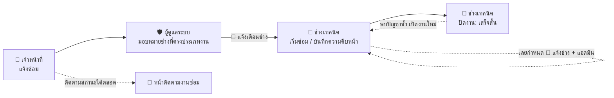
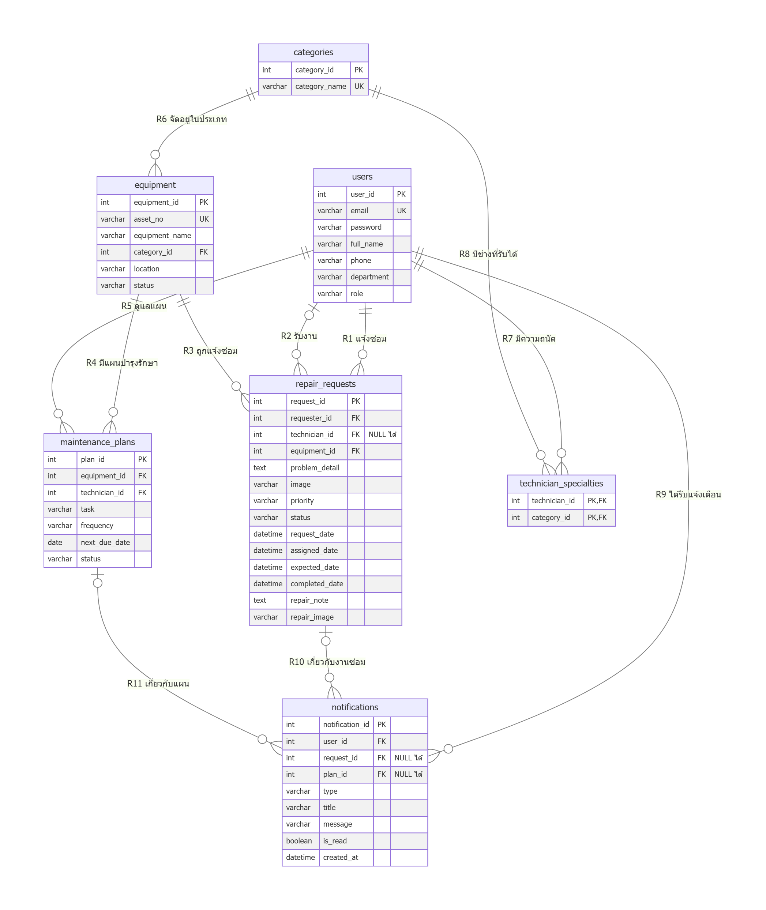
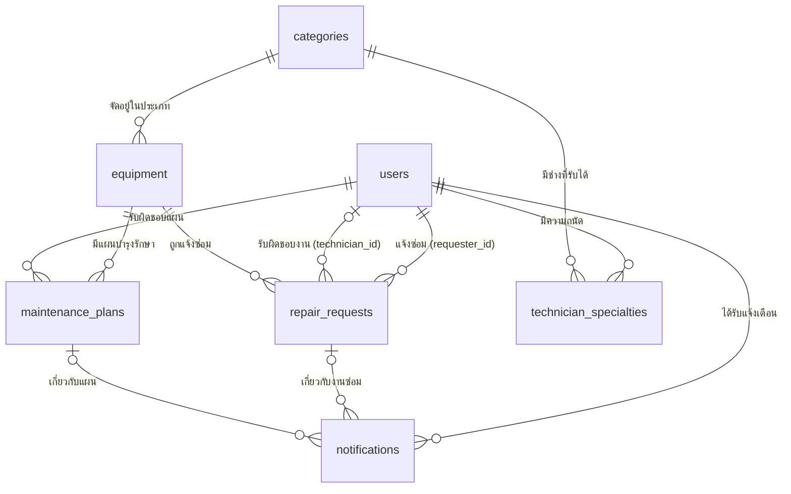

# เอกสารระบบแจ้งซ่อมและบำรุงรักษา มหาวิทยาลัยรังสิต
### RSU Smart Repair & Maintenance System — System Documentation

**วิชา CSC481** · วิทยาลัยนวัตกรรมดิจิทัลเทคโนโลยี (DIT) ร่วมกับสำนักงานอาคารและสิ่งแวดล้อม (ตึก 13) · มหาวิทยาลัยรังสิต

---

## 📌 สารบัญ

1. [ภาพรวมระบบและผู้ใช้งาน](#1-ภาพรวมระบบและผู้ใช้งาน)
2. [ขั้นตอนการทำงานของระบบ (Workflow)](#2-ขั้นตอนการทำงานของระบบ-workflow)
3. [สคริปต์เดโมสำหรับการนำเสนอ](#3-สคริปต์เดโมสำหรับการนำเสนอ)
4. [การออกแบบฐานข้อมูล (ERD)](#4-การออกแบบฐานข้อมูล-erd)
5. [กฎทางธุรกิจที่ระบบคำนวณให้อัตโนมัติ](#5-กฎทางธุรกิจที่ระบบคำนวณให้อัตโนมัติ)
6. [แนวทางตอบคำถามอาจารย์](#6-แนวทางตอบคำถามอาจารย์)
7. [ข้อจำกัดและแนวทางพัฒนาต่อ](#7-ข้อจำกัดและแนวทางพัฒนาต่อ)
8. [การแก้ปัญหาเบื้องต้นและการ Deploy](#8-การแก้ปัญหาเบื้องต้นและการ-deploy)

---

## 1. ภาพรวมระบบและผู้ใช้งาน

ระบบเว็บแอปพลิเคชันสำหรับรับแจ้งซ่อมครุภัณฑ์ภายในมหาวิทยาลัยรังสิต ช่วยให้ผู้แจ้ง หัวหน้าฝ่ายอาคารฯ และช่างเทคนิค ทำงานบนข้อมูลชุดเดียวกัน ตั้งแต่แจ้งปัญหาจนปิดงาน รวมถึงวางแผนบำรุงรักษาเชิงป้องกันก่อนอุปกรณ์จะชำรุด

### ผู้ใช้งาน 3 บทบาท

| บทบาท | ใครเป็นผู้ใช้ | หน้าที่หลักในระบบ | หน้าแรกหลังล็อกอิน |
| :--- | :--- | :--- | :--- |
| 📝 **เจ้าหน้าที่** | อาจารย์ / บุคลากรของคณะ | แจ้งซ่อม และติดตามสถานะงาน | ภาพรวมงานซ่อม |
| 🔧 **ช่างเทคนิค** | ช่างประจำอาคาร ฝ่ายอาคารฯ ตึก 13 แยกตามประเภทงานที่ถนัด | รับงานเฉพาะประเภทของตัวเอง อัปเดตความคืบหน้า บันทึกผลการซ่อม และทำงานบำรุงรักษาตามแผนของตัวเอง | งานที่ได้รับมอบหมาย |
| 🛡️ **ผู้ดูแลระบบ** | หัวหน้าฝ่ายอาคารฯ ตึก 13 | มอบหมายช่าง จัดการทะเบียนครุภัณฑ์ และวางแผนบำรุงรักษา | ภาพรวมงานซ่อม |

### บัญชีสมาชิกกลุ่ม (ใช้เดโม)

| ลำดับ | รหัสนักศึกษา | ชื่อ - นามสกุล | อีเมล | รหัสผ่าน | บทบาท | หน่วยงาน |
| :---: | :---: | :--- | :--- | :---: | :--- | :--- |
| 1 | 6800401 | ณพัชรกัณฑ์ พัชญ์ชัยพงศา | `naphatcharakan.p68@rsu.ac.th` | `admin123` | 🛡️ ผู้ดูแลระบบหลัก | วิทยาลัยนวัตกรรมดิจิทัลเทคโนโลยี |
| 2 | 6803317 | ธนากร ยั่งยืน | `thanakorn.y68@rsu.ac.th` | `password123` | 🔧 ช่างระบบปรับอากาศ (ตึก 1-5) | สำนักงานอาคารและสิ่งแวดล้อม (ตึก 13) |
| 3 | 6803162 | สรวิชญ์ ทองพลับ | `sorawit.t68@rsu.ac.th` | `password123` | 📝 เจ้าหน้าที่ (ผู้แจ้งซ่อม) | วิทยาลัยนวัตกรรมดิจิทัลเทคโนโลยี |
| 4 | 6803498 | ณภัทร สาระคำ | `naphat.s68@rsu.ac.th` | `password123` | 🔧 ช่างระบบไฟฟ้าและประปา (ตึก 6-12) | สำนักงานอาคารและสิ่งแวดล้อม (ตึก 13) |
| 5 | 6804265 | ชาติวุฒิ ทองจีน | `chartwut.t68@rsu.ac.th` | `password123` | 🛡️ ผู้ดูแลระบบ (หัวหน้าฝ่ายอาคารฯ) | สำนักงานอาคารและสิ่งแวดล้อม (ตึก 13) |

### บัญชีช่างตัวอย่าง (ไม่ใช่สมาชิกกลุ่ม)

เพิ่มเพื่อให้ทุกประเภทงานมีช่างรับผิดชอบ

| ลำดับ | ชื่อ - นามสกุล | อีเมล | รหัสผ่าน | บทบาท |
| :---: | :--- | :--- | :---: | :--- |
| 6 | ประเสริฐ ใจดี | `prasert.j@rsu.ac.th` | `password123` | 🔧 ช่างคอมพิวเตอร์และอุปกรณ์สำนักงาน |
| 7 | สมศักดิ์ แก้วมณี | `somsak.k@rsu.ac.th` | `password123` | 🔧 ช่างอาคารและสถานที่ |

### ช่างแต่ละคนรับงานประเภทไหน

| ประเภทงาน (ของครุภัณฑ์) | ช่างที่รับได้ |
| :--- | :--- |
| ระบบปรับอากาศ | ธนากร ยั่งยืน |
| ระบบไฟฟ้า | ณภัทร สาระคำ |
| ระบบประปา | ณภัทร สาระคำ |
| คอมพิวเตอร์ | ประเสริฐ ใจดี |
| อุปกรณ์สำนักงาน | ประเสริฐ ใจดี |
| อาคารและสถานที่ | สมศักดิ์ แก้วมณี |

ระบบ **ไม่ยอมให้มอบหมายงานผิดสาย** — หน้าต่างมอบหมายช่างและฟอร์มเพิ่มแผนบำรุงรักษาแสดงเฉพาะช่างที่รับงานประเภทนั้นได้ และฝั่งข้อมูลก็ตรวจซ้ำก่อนบันทึก ช่างที่สมัครใหม่ต้องเลือกประเภทงานที่รับได้อย่างน้อย 1 ประเภท

> 💡 ที่หน้า Login กดปุ่มชื่อสมาชิกเพื่อกรอกอีเมล/รหัสผ่านให้อัตโนมัติ ถ้าจะสลับไปดูอีกบทบาท ให้ **ออกจากระบบ** แล้วล็อกอินด้วยบัญชีนั้น

### หน้าจอทั้งหมด

| GUI | ไฟล์ | หน้าจอ | ผู้ที่เข้าได้ |
| :---: | :--- | :--- | :--- |
| 1 | `login.html` | เข้าสู่ระบบ / สมัครสมาชิก / ลืมรหัสผ่าน | ทุกคน |
| 2 | `index.html` | ภาพรวมงานซ่อม (+ ปุ่มมอบหมายช่างสำหรับแอดมิน, ป้าย "เกินกำหนด") | ทุกบทบาท |
| 3 | `new-request.html` | แจ้งซ่อมใหม่ | ทุกบทบาท |
| 4, 8 | `track-repair.html` | ติดตามงานซ่อม + Timeline (GUI-8 คือมุมมองมือถือ) | ทุกบทบาท |
| 5 | `assigned-tasks.html` | งานที่ได้รับมอบหมาย / อัปเดตสถานะงาน | ช่างเทคนิค, ผู้ดูแลระบบ |
| 6 | `assets.html` | ทะเบียนครุภัณฑ์ + ประวัติการซ่อม | ทุกบทบาท (เพิ่มครุภัณฑ์ได้เฉพาะแอดมิน) |
| 7 | `maintenance-plans.html` | แผนบำรุงรักษาเชิงป้องกัน | ช่างเทคนิค (บันทึก/เลื่อนกำหนดได้เฉพาะแผนของตัวเอง), ผู้ดูแลระบบ (เพิ่มแผนได้เฉพาะแอดมิน) |
| ทุกหน้า | กระดิ่งมุมขวาบน | การแจ้งเตือน: ได้รับมอบหมายงาน/แผน, งานหรือแผนเกินกำหนด | ทุกบทบาท (เห็นเฉพาะของตัวเอง) |

---

## 2. ขั้นตอนการทำงานของระบบ (Workflow)



### ขั้นที่ 1 — แจ้งปัญหา (เจ้าหน้าที่)
1. ไปที่ **แจ้งซ่อมใหม่**
2. เลือกครุภัณฑ์ เช่น `PL-008 · ชุดก๊อกน้ำอ่างล้างมือ` → ระบบกรอกสถานที่ให้อัตโนมัติ (`ตึก 6 โรงอาหารกลาง · ชั้น 1 · ห้องน้ำ`)
3. กรอก **หัวข้อปัญหา** และ **รายละเอียด** เลือกความสำคัญ (ต่ำ / ปกติ / เร่งด่วน) และแนบรูปหน้างานได้
4. กด **ส่งคำขอแจ้งซ่อม** → ได้เลขใบแจ้งซ่อม เช่น `RQ-691105-001` แล้วระบบพาไปหน้าติดตามงานทันที
5. สถานะใบแจ้งซ่อม = **รอดำเนินการ** · สถานะครุภัณฑ์เปลี่ยนเป็น **รอตรวจสอบ**

### ขั้นที่ 2 — มอบหมายช่าง (ผู้ดูแลระบบ)
1. ที่ **ภาพรวมงานซ่อม** งานที่ยังไม่มีช่างจะแสดง "รอมอบหมาย" พร้อมปุ่ม **มอบหมาย**
2. หน้าต่างมอบหมายแสดง **ประเภทงานของครุภัณฑ์** และ **รายชื่อเฉพาะช่างที่รับงานประเภทนั้นได้** เช่น งานแอร์ → เลือกได้แค่ ธนากร · งานประปา → เลือกได้แค่ ณภัทร
3. Timeline ขั้นที่ 2 เปลี่ยนเป็น "เสร็จแล้ว" พร้อมชื่อผู้มอบหมายและเวลา · งานจะไปขึ้นในหน้าของช่างคนนั้น
4. ระบบ **ส่งแจ้งเตือน "ได้รับมอบหมายงานซ่อม"** ถึงช่าง (ตัวเลขขึ้นที่กระดิ่ง กดแล้วเปิดใบงานนั้นทันที)
5. ถ้ามอบหมายผิดคน กด **เปลี่ยนช่าง** ได้ (จนกว่างานจะเสร็จ) ช่างคนใหม่จะได้รับแจ้งเตือน

### ขั้นที่ 3 — ซ่อมและอัปเดตงาน (ช่างเทคนิค)
1. ช่างล็อกอินแล้วเข้าหน้า **งานที่ได้รับมอบหมาย** โดยตรง เห็นเฉพาะงานของตนเอง หัวรายการบอกประเภทงานที่ตนรับ · งานที่เลยกำหนดมีป้าย **เกินกำหนด**
2. เลือกงานจากรายการ แล้วในฟอร์มด้านขวา:
   - เลือกสถานะ **กำลังดำเนินการ** → สถานะครุภัณฑ์เป็น **อยู่ระหว่างซ่อม**
   - กรอกรายละเอียดการดำเนินงาน, วันที่และเวลาที่คาดว่าจะเสร็จ, แนบหลักฐาน
3. กด **บันทึก** → Timeline ขั้นที่ 3 แสดงชื่อช่าง เวลา และบันทึกการซ่อม

### ขั้นที่ 4 — ปิดงาน (ช่างเทคนิค)
1. เลือกสถานะ **เสร็จสิ้น** แล้วบันทึก
2. ระบบบันทึกวันเวลาที่เสร็จ (`completed_date`), Timeline ครบทั้ง 4 ขั้น, และครุภัณฑ์กลับเป็น **ใช้งานปกติ** (ถ้าไม่มีใบแจ้งซ่อมอื่นค้าง)
3. ถ้าปัญหากลับมา ช่างเปลี่ยนสถานะกลับเป็น "กำลังดำเนินการ" ได้ ระบบจะเปิด Timeline ขั้นที่ 4 กลับเป็นรอดำเนินการ

### ติดตามงาน (ทุกบทบาท)
หน้า **ติดตามงานซ่อม** แสดงรายละเอียดปัญหา, ไฟล์แนบ (ดูภาพตัวอย่างได้), ช่างผู้รับผิดชอบพร้อมเบอร์ติดต่อ, เวลาคาดว่าจะเสร็จ และ Timeline 4 ขั้น:

| ขั้น | ชื่อขั้นตอน | เสร็จเมื่อ |
| :---: | :--- | :--- |
| 1 | ส่งคำขอแจ้งซ่อม | ผู้แจ้งส่งแบบฟอร์ม |
| 2 | รับเรื่องและมอบหมายช่าง | แอดมินมอบหมายช่าง |
| 3 | กำลังดำเนินการ | ช่างเริ่มงานและบันทึกความคืบหน้า |
| 4 | ซ่อมเสร็จและตรวจรับ | ช่างปิดงานเป็น "เสร็จสิ้น" |

### การแจ้งเตือน (กระดิ่งมุมขวาบน)

| เหตุการณ์ | แจ้งใคร | ข้อความ |
| :--- | :--- | :--- |
| แอดมินมอบหมายงานซ่อม | ช่างที่ได้รับมอบหมาย | ได้รับมอบหมายงานซ่อม · เลขใบงาน · อาการ · สถานที่ |
| แอดมินสร้างแผนบำรุงรักษา | ช่างผู้รับผิดชอบแผน | ได้รับมอบหมายแผนบำรุงรักษา · รหัสแผน · งาน · กำหนด |
| งานซ่อมเลยกำหนดแล้วยังไม่เสร็จ | ช่างที่รับงาน + **แอดมินทุกคน** (ถ้ายังไม่มอบหมาย แจ้งแอดมินอย่างเดียว) | งานซ่อมเกินกำหนด · เลขใบงาน · กำหนดเดิม · ชื่อช่าง |
| แผนบำรุงรักษาเลยกำหนดแล้วยังไม่บันทึกผล | ช่างผู้รับผิดชอบ + **แอดมินทุกคน** | แผนบำรุงรักษาเกินกำหนด · รหัสแผน · กำหนดเดิม |

- **"กำหนด" ของงานซ่อม** = วันเวลาที่ช่างคาดว่าจะเสร็จ (ETA) · ถ้าช่างยังไม่ใส่ ใช้วันที่แจ้ง + **1 วัน (เร่งด่วน) / 3 วัน (ปกติ) / 7 วัน (ต่ำ)**
- ระบบตรวจงานเกินกำหนดทุกครั้งที่เปิดหน้า และแจ้งเรื่องเดียวกัน **ครั้งเดียวต่อกำหนด** (ถ้าช่างเลื่อน ETA แล้วเลยอีก จะแจ้งใหม่)
- กดรายการแจ้งเตือน → ระบบบันทึกว่าอ่านแล้วและเปิดหน้าที่เกี่ยวข้อง (ช่างไปหน้างานของตัวเอง แอดมินไปหน้าติดตามงาน) · มีปุ่ม **อ่านทั้งหมด**
- เข้าระบบครั้งแรกในรอบการใช้งาน ถ้ามีรายการที่ยังไม่อ่าน จะมีข้อความเด้งบอกจำนวน

### งานบำรุงรักษาเชิงป้องกัน (ช่างเทคนิค / ผู้ดูแลระบบ)
- **แผนบำรุงรักษา**: แสดงงานตามเดือน (เดือนปัจจุบันรวมงานที่ค้างจากเดือนก่อน) เลื่อนดูเดือนอื่นได้
- **เพิ่มแผน (แอดมิน)**: เลือกครุภัณฑ์แล้วรายชื่อผู้รับผิดชอบจะเหลือเฉพาะช่างที่รับงานประเภทนั้นได้
- ช่างกด **บันทึกการทำบำรุง / เลื่อนกำหนด** ได้เฉพาะแผนที่ตัวเองรับผิดชอบ · แอดมินทำได้ทุกแผน
- **บันทึกการทำบำรุง** → บันทึกวันที่ทำล่าสุด และเลื่อนกำหนดครั้งถัดไป = วันนี้ + รอบดูแล
- **เลื่อนกำหนด** → เลือกวันที่ใหม่
- **ทะเบียนครุภัณฑ์**: คอลัมน์ "บำรุงรักษาครั้งถัดไป" ดึงจากแผนที่ใกล้ที่สุดของครุภัณฑ์ชิ้นนั้น และดูประวัติการแจ้งซ่อมทั้งหมดได้

---

## 3. สคริปต์เดโมสำหรับการนำเสนอ

ใช้เวลาประมาณ 10-12 นาที · ใช้ **เบราว์เซอร์เดียวกันตลอด** (ข้อมูลอยู่ใน LocalStorage)

| # | ผู้นำเสนอล็อกอินเป็น | สิ่งที่ทำ | จุดที่ควรชี้ให้ดู |
| :---: | :--- | :--- | :--- |
| 1 | (ยังไม่ล็อกอิน) | เปิด `/` หรือ `index.html` | ระบบพาไปหน้า Login เอง (Auth Guard) |
| 2 | 📝 สรวิชญ์ | ดูเมนูด้านซ้าย | ไม่มีเมนู "งานที่ได้รับมอบหมาย" และ "แผนบำรุงรักษา" (แบ่งสิทธิ์) |
| 3 | 📝 สรวิชญ์ | แจ้งซ่อมใหม่: เลือก `PL-008` → กรอกหัวข้อ "ก๊อกน้ำรั่ว" → เลือกความสำคัญ → แนบรูป → ส่ง | สถานที่กรอกให้เอง, ได้เลขใบแจ้งซ่อมตามวันที่วันนี้, Timeline ขั้นที่ 1 เสร็จ |
| 4 | 🛡️ ณพัชรกัณฑ์ | ภาพรวมงานซ่อม → กด **มอบหมาย** ที่ใบใหม่ | หน้าต่างบอก "ประเภทงาน: ระบบประปา" และ **มีให้เลือกแค่ ณภัทร** (ช่างแอร์ไม่อยู่ในรายชื่อ) |
| 5 | 🛡️ ณพัชรกัณฑ์ | เลือก **ณภัทร** → บันทึก · แล้วกดกระดิ่งมุมขวาบน | Timeline ขั้นที่ 2 เสร็จ · กระดิ่งของแอดมินมีรายการ "งานซ่อมเกินกำหนด" / "แผนบำรุงรักษาเกินกำหนด" พร้อมชื่อช่าง |
| 6 | 🔧 ณภัทร | ล็อกอิน → กดกระดิ่ง → กด "ได้รับมอบหมายงานซ่อม" | ข้อความเด้งบอกจำนวนแจ้งเตือน · กดแล้วเปิดใบงานนั้นในหน้างานของช่างทันที · ตัวเลขกระดิ่งลดลง |
| 7 | 🔧 ณภัทร | เลือกสถานะ "กำลังดำเนินการ" + บันทึกการซ่อม | เห็นเฉพาะงานไฟฟ้า/ประปาของตัวเอง, ทะเบียนครุภัณฑ์ PL-008 เป็น "อยู่ระหว่างซ่อม" |
| 8 | 🔧 ณภัทร | เปลี่ยนสถานะเป็น "เสร็จสิ้น" | Timeline ครบ 4 ขั้น, PL-008 กลับเป็น "ใช้งานปกติ" |
| 9 | 🔧 ณภัทร | แผนบำรุงรักษา | ปุ่มจัดการขึ้นเฉพาะแผนของตัวเอง (PM-6911-002, PM-6911-004) |
| 10 | 📝 สรวิชญ์ | ติดตามงานซ่อม → เลือกใบงาน → ดูไฟล์แนบ | ชื่อช่าง, บันทึกการซ่อม, ภาพตัวอย่างไฟล์แนบ |
| 11 | 🛡️ ณพัชรกัณฑ์ | แผนบำรุงรักษา → **เพิ่มแผน** → เลือกครุภัณฑ์ AC-003 แล้วเปลี่ยนเป็น PR-012 | รายชื่อผู้รับผิดชอบเปลี่ยนตามประเภท (แอร์ → ธนากร, อุปกรณ์สำนักงาน → ประเสริฐ) |
| 12 | 🛡️ ณพัชรกัณฑ์ | งาน "เกินกำหนด" → บันทึกการทำบำรุง · กด **ส่งออกข้อมูล** | กำหนดครั้งถัดไปเลื่อนตามรอบ, ตัวนับเกินกำหนดลดลง, ได้ไฟล์ CSV |

> 🔄 ถ้าต้องการเริ่มเดโมใหม่ด้วยข้อมูลตั้งต้น ดู [ล้างข้อมูลกลับเป็นค่าเริ่มต้น](#ล้างข้อมูลกลับเป็นค่าเริ่มต้น)

---

## 4. การออกแบบฐานข้อมูล (ERD)

ERD ฉบับปรับปรุงมี **7 ตาราง** (เพิ่ม `categories`, `technician_specialties`, `notifications` จากฉบับแรก)



> 📘 **คำอธิบาย ERD ฉบับเต็ม** (คีย์แต่ละตัวใช้ทำอะไร, Attribute ทุกตัว, Cardinality แบบ min-max, Data Dictionary, Integrity Constraints, ตัวอย่างข้อมูล, คำสั่ง SQL, ตัวอย่าง Query, การตรวจ Normalization และโค้ดสำหรับวาด ERD ใหม่): **[ERD_DOCUMENTATION.md](ERD_DOCUMENTATION.md)**



| ตาราง | หน้าที่ | ตอบโจทย์อะไร |
| :--- | :--- | :--- |
| `users` | ผู้ใช้ทุกบทบาท | แบ่งสิทธิ์ตาม `role` |
| `categories` | ประเภทงาน 6 ประเภท | ตัวกลางจับคู่ครุภัณฑ์กับช่าง |
| `technician_specialties` | ช่างคนไหนรับงานประเภทไหนได้ (M : N) | **แยกช่างตามความถนัด** ช่างแอร์รับงานประปาไม่ได้ |
| `equipment` | ทะเบียนครุภัณฑ์ (อ้างอิงประเภทด้วย `category_id`) | รู้ว่างานนี้ต้องใช้ช่างสายไหน |
| `repair_requests` | ใบแจ้งซ่อม | ติดตามงานตั้งแต่แจ้งจนปิดงาน |
| `maintenance_plans` | แผนบำรุงรักษาเชิงป้องกัน | ดูแลก่อนพัง |
| `notifications` | การแจ้งเตือน | **แจ้งช่างเมื่อได้รับมอบหมาย และเมื่องาน/แผนเกินกำหนด** |

---

## 5. กฎทางธุรกิจที่ระบบคำนวณให้อัตโนมัติ

| เรื่อง | กฎ |
| :--- | :--- |
| **เลขใบแจ้งซ่อม** | `RQ-` + ปี พ.ศ. 2 หลัก + เดือน + วัน + `-` + ลำดับของวันนั้น เช่น `RQ-691105-001` (ไม่ซ้ำกันเสมอ) |
| **สถานะครุภัณฑ์** | มีใบแจ้งซ่อมที่ "กำลังดำเนินการ" → `อยู่ระหว่างซ่อม` · มีใบค้างที่ยังไม่เริ่ม → `รอตรวจสอบ` · ไม่มีใบค้าง → `ใช้งานปกติ` |
| **สถานะแผนบำรุงรักษา** | เลยกำหนดแล้ว → `เกินกำหนด` · เหลือไม่เกิน 7 วัน → `ใกล้ครบกำหนด` · นอกนั้น → `รอดำเนินการ` |
| **กำหนดครั้งถัดไป** | เมื่อกด "บันทึกการทำบำรุง" = วันนี้ + รอบดูแล (เช่น ทุก 3 เดือน) |
| **ตัวเลขบน Dashboard** | นับจากใบแจ้งซ่อมจริง · "เร่งด่วน" นับเฉพาะงานเร่งด่วนที่ยังไม่เสร็จ |
| **มอบหมายช่าง** | ช่างต้องมีความถนัดตรงกับประเภทงานของครุภัณฑ์ (`technician_specialties`) ทั้งงานซ่อมและแผนบำรุงรักษา · ตรวจทั้งในหน้าจอและก่อนบันทึก |
| **กำหนดเสร็จของงานซ่อม** | ETA ที่ช่างใส่ · ถ้ายังไม่มี = วันที่แจ้ง + 1 / 3 / 7 วัน (เร่งด่วน / ปกติ / ต่ำ) · เลยแล้วยังไม่เสร็จ = **เกินกำหนด** |
| **การแจ้งเตือน** | มอบหมายงานหรือแผน → แจ้งช่าง · งานหรือแผนเกินกำหนด → แจ้งช่างที่รับผิดชอบ + แอดมินทุกคน · เรื่องเดียวกันแจ้งครั้งเดียวต่อกำหนด |
| **ไฟล์แนบ** | รูปภาพขนาดไม่เกิน 1 MB เก็บภาพตัวอย่างไว้ดูได้ ไฟล์อื่นเก็บเฉพาะชื่อและขนาด |
| **การสมัครสมาชิก** | สมัครเองได้เฉพาะบทบาทเจ้าหน้าที่และช่างเทคนิค อีเมลห้ามซ้ำ · ช่างต้องเลือกประเภทงานที่รับได้อย่างน้อย 1 ประเภท |
| **รีเซ็ตรหัสผ่าน** | ต้องกรอกอีเมลและเบอร์โทรให้ตรงกับที่ลงทะเบียนไว้ |
| **ความปลอดภัยของข้อมูลที่แสดง** | ข้อความทุกอย่างที่ผู้ใช้กรอกจะถูก escape ก่อนแสดงบนหน้าเว็บ ป้องกัน XSS |

---

## 6. แนวทางตอบคำถามอาจารย์

### Q1: ทำไม `repair_requests` มี Foreign Key ชี้ไปที่ `users` ถึง 2 เส้น?
> "เพราะใบแจ้งซ่อม 1 ใบเกี่ยวข้องกับผู้ใช้ 2 บทบาทครับ คือ `requester_id` = ผู้แจ้ง และ `technician_id` = ช่างที่รับผิดชอบ ทั้งสองคนเป็นบุคลากรเหมือนกัน จึงเก็บในตาราง `users` ตารางเดียวแล้วแยกด้วยฟิลด์ `role` ลดข้อมูลซ้ำซ้อน และรองรับกรณีช่างแจ้งซ่อมอุปกรณ์ในห้องของตัวเองได้ด้วย ส่วน `technician_id` เป็น NULL ได้ เพราะตอนแจ้งซ่อมยังไม่ได้มอบหมายช่าง"

### Q2: ทำไมแยกตาราง `equipment` ออกจาก `repair_requests`?
> "เป็นความสัมพันธ์ 1 : M ครับ ครุภัณฑ์ 1 ชิ้นถูกแจ้งซ่อมได้หลายครั้งตลอดอายุการใช้งาน ถ้าเก็บชื่อและสถานที่ไว้ในใบแจ้งซ่อมทุกใบ ข้อมูลจะซ้ำ และถ้าย้ายเครื่องไปห้องอื่นต้องแก้หลายแถว (Update Anomaly) การแยกตารางยังทำให้ดูประวัติการซ่อมของครุภัณฑ์แต่ละชิ้นได้ ซึ่งระบบมีหน้านี้ให้ดูจริงในทะเบียนครุภัณฑ์"

### Q3: ฐานข้อมูลผ่าน Normalization ระดับไหน?
> "การออกแบบตาม ERD ผ่าน 3NF ครับ
> - **1NF:** ทุกฟิลด์เป็นค่าเดี่ยว ความถนัดของช่างที่มีหลายค่าแยกเป็นหลายแถวใน `technician_specialties` ไม่ได้เก็บรวมในช่องเดียว
> - **2NF:** ตารางที่ใช้ Composite PK มีแค่ `technician_specialties` ซึ่งไม่มีฟิลด์อื่นนอกจาก PK จึงไม่มี Partial Dependency
> - **3NF:** ไม่มี Transitive Dependency เช่น ชื่อประเภทงานแยกไปอยู่ `categories` ไม่ได้เก็บซ้ำทุกแถวใน `equipment` และข้อมูลครุภัณฑ์ขึ้นกับ `equipment_id` ไม่ได้ขึ้นกับ `request_id`
>
> ส่วนในฐานข้อมูลจำลองบนเบราว์เซอร์ เราเก็บฟิลด์แสดงผลบางตัวซ้ำ เช่น ชื่อครุภัณฑ์ในแผนบำรุงรักษา เพราะไม่มีเซิร์ฟเวอร์ทำ JOIN ถ้าทำระบบจริงจะตัดฟิลด์เหล่านี้ออกแล้ว JOIN จาก Foreign Key แทนครับ"

### Q4: ทำไม `status` ของแผนบำรุงรักษาถึงคำนวณจากวันที่ แทนที่จะให้คนกรอก?
> "เพราะสถานะ 'เกินกำหนด' และ 'ใกล้ครบกำหนด' ขึ้นกับวันที่ปัจจุบันครับ ถ้าเก็บเป็นค่าคงที่ วันเวลาผ่านไปข้อมูลจะผิดเอง การคำนวณจาก `next_due_date` ทำให้ถูกต้องเสมอ ในฐานข้อมูลจริงอาจทำเป็น View หรือ Computed Column"

### Q5: Timeline 4 ขั้นตอนเก็บอย่างไร? ถ้าทำเป็นฐานข้อมูลจริงจะออกแบบอย่างไร?
> "ในเดโมเก็บเป็น Array `timeline` อยู่ในใบแจ้งซ่อมครับ ถ้าทำจริงควรแยกเป็นตาราง `repair_status_logs` (log_id, request_id FK, user_id FK, status, note, created_at) ความสัมพันธ์ 1 : M กับใบแจ้งซ่อม จะเก็บประวัติการเปลี่ยนสถานะได้ทุกครั้งและตรวจสอบย้อนหลังได้"

### Q6: ทำไมความถนัดของช่างต้องแยกเป็นตาราง `technician_specialties` ไม่เก็บเป็นช่องใน `users`?
> "เพราะช่าง 1 คนรับได้หลายประเภท และประเภทหนึ่งมีช่างได้หลายคน เป็นความสัมพันธ์ M : N ครับ ถ้าเก็บเป็นช่องเดียวใน `users` เช่น 'ไฟฟ้า, ประปา' จะผิด 1NF และค้นหาช่างประปายาก จึงสร้างตารางเชื่อมที่มี Composite Primary Key `(technician_id, category_id)` แตกเป็น 1 : M สองเส้น ตอนมอบหมายงาน ระบบดูประเภทของครุภัณฑ์แล้วดึงเฉพาะช่างที่มีคู่นี้อยู่ ช่างแอร์จึงไม่โผล่ในรายชื่อตอนมอบหมายงานประปา"

### Q7: แจ้งเตือนทำงานอย่างไร? รู้ได้ยังไงว่างานเกินกำหนด?
> "มีตาราง `notifications` ครับ ทุกครั้งที่แอดมินมอบหมายงานหรือสร้างแผน ระบบเพิ่มแถวแจ้งเตือนถึงช่าง ส่วนงานเกินกำหนด ระบบตรวจทุกครั้งที่เปิดหน้า โดยเทียบเวลาปัจจุบันกับ ETA ที่ช่างใส่ ถ้ายังไม่มี ETA ใช้วันที่แจ้งบวกจำนวนวันตามความสำคัญ เกินแล้วยังไม่เสร็จก็แจ้งทั้งช่างและแอดมิน ช่อง `is_read` ใช้นับตัวเลขบนกระดิ่ง และเรื่องเดียวกันจะแจ้งครั้งเดียวต่อกำหนด ไม่แจ้งซ้ำทุกครั้งที่เปิดหน้า ระบบจริงจะใช้งานตั้งเวลา (Cron Job) บนเซิร์ฟเวอร์ตรวจแทน และส่งอีเมลหรือ LINE ร่วมด้วย"

### Q8: ป้องกันไม่ให้เจ้าหน้าที่เข้าหน้าของช่างได้อย่างไร?
> "มี Auth Guard ใน `js/app.js` ตรวจทุกหน้าครับ ถ้ายังไม่ล็อกอินจะพาไปหน้า Login ถ้าบทบาทไม่มีสิทธิ์จะพากลับหน้าหลัก และซ่อนเมนูกับปุ่มที่ไม่มีสิทธิ์ แต่เนื่องจากเป็นเว็บที่ไม่มีเซิร์ฟเวอร์ การตรวจสิทธิ์นี้ทำในเบราว์เซอร์ ระบบจริงต้องตรวจซ้ำที่ฝั่งเซิร์ฟเวอร์ (API) ด้วย"

---

## 7. ข้อจำกัดและแนวทางพัฒนาต่อ

| ข้อจำกัดของเวอร์ชันนี้ | แนวทางในระบบจริง |
| :--- | :--- |
| ข้อมูลเก็บใน **LocalStorage** ของเบราว์เซอร์ แต่ละเครื่อง/เบราว์เซอร์มีข้อมูลแยกกัน | ใช้ฐานข้อมูลบนเซิร์ฟเวอร์ (เช่น MySQL / PostgreSQL) ผ่าน REST API |
| รหัสผ่านเก็บเป็นข้อความธรรมดา | เก็บเป็น Hash (bcrypt) และใช้ Session / JWT |
| ตรวจสิทธิ์เฉพาะฝั่งเบราว์เซอร์ | ตรวจสิทธิ์ซ้ำที่ API ทุกครั้ง |
| ปุ่มบัญชีสมาชิกในหน้า Login มีไว้ช่วยเดโม | ลบออกเมื่อใช้งานจริง |
| รีเซ็ตรหัสผ่านด้วยการยืนยันเบอร์โทร | ส่งลิงก์รีเซ็ตทางอีเมล @rsu.ac.th |
| แจ้งเตือนเฉพาะในเว็บ (กระดิ่ง) และตรวจงานเกินกำหนดตอนเปิดหน้า | ใช้ Cron Job บนเซิร์ฟเวอร์ตรวจตามเวลา และส่งอีเมล / LINE ร่วมด้วย · แจ้งผู้แจ้งเมื่องานของตัวเองคืบหน้า |
| ไฟล์แนบเก็บในเบราว์เซอร์ จำกัดขนาด | อัปโหลดไปที่ File Storage (เช่น S3) |
| ผู้แจ้งยังไม่มีปุ่มยืนยันตรวจรับงาน | เพิ่มขั้นตอนให้ผู้แจ้งกดยืนยันหรือขอให้แก้ไขใหม่ |

---

## 8. การแก้ปัญหาเบื้องต้นและการ Deploy

### ลืมรหัสผ่าน
1. หน้า Login กด **ลืมรหัสผ่าน?**
2. กรอกอีเมล และเบอร์โทร/เบอร์ต่อที่ลงทะเบียนไว้ (เช่น `ต่อ 1302` สำหรับบัญชี `naphatcharakan.p68@rsu.ac.th`)
3. ตั้งรหัสผ่านใหม่อย่างน้อย 6 ตัวอักษร แล้วกด **ยืนยันรีเซ็ตรหัสผ่าน** ระบบกรอกข้อมูลลงฟอร์ม Login ให้พร้อมเข้าสู่ระบบ

### ล้างข้อมูลกลับเป็นค่าเริ่มต้น
ใช้เมื่อต้องการเริ่มเดโมใหม่ หรือข้อมูลทดสอบรก
1. กด `F12` → แท็บ **Application** → **Local Storage** → เลือกโดเมนของเว็บ
2. คลิกขวา → **Clear** แล้วรีเฟรชหน้า
3. ระบบสร้างข้อมูลตั้งต้นใหม่ (ผู้ใช้ 7 คน, ประเภทงาน 6 ประเภท, ครุภัณฑ์ 8 รายการ, ใบแจ้งซ่อม 7 ใบ, แผนบำรุงรักษา 7 แผน)

> ถ้าต้องการแก้ข้อมูลตั้งต้นถาวร แก้ได้ที่ `DEFAULT_USERS`, `DEFAULT_CATEGORIES`, `DEFAULT_TECHNICIAN_SPECIALTIES`, `DEFAULT_EQUIPMENT`, `DEFAULT_REPAIRS`, `DEFAULT_MAINTENANCE_PLANS` ใน `js/data.js`

### รันบนเครื่อง
```bash
python -m http.server 3000
```
แล้วเปิด `http://localhost:3000/` (ยังไม่ล็อกอินจะถูกพาไปหน้า Login)

### Deploy บน Vercel
1. เข้า [vercel.com](https://vercel.com) → **Add New Project**
2. เลือก Repository [novterss/Repair-Center-Rangsit-University-RSU-](https://github.com/novterss/Repair-Center-Rangsit-University-RSU-) → Framework: **Other** → **Deploy**
3. หลังจากนั้นทุกครั้งที่ push ขึ้น `main` Vercel จะ deploy ใหม่ให้อัตโนมัติ

`vercel.json` เปิด Clean URLs ไว้ จึงเปิดหน้าได้ทั้ง `/assets` และ `/assets.html` และมีทางลัด `/dashboard` → หน้าภาพรวม, `/login` → หน้าเข้าสู่ระบบ
